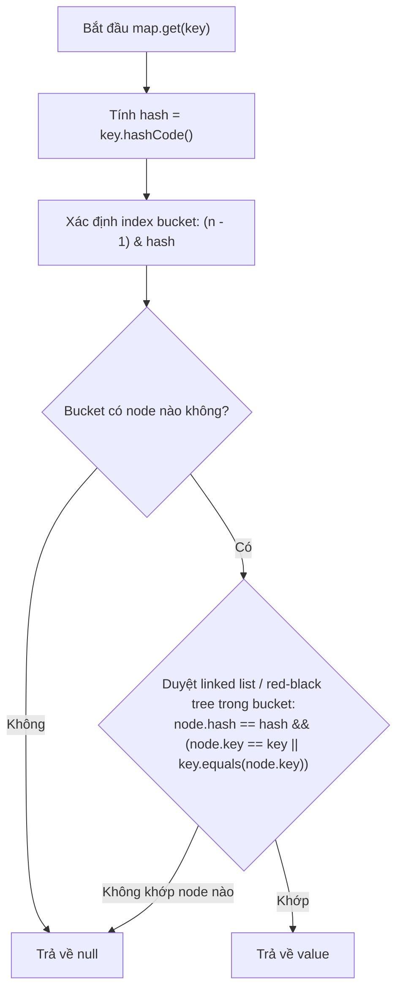

# equals() và hashCode() Contract

> Tag: #java #core #collections #hashmap
> Ngày tạo: 2026-10-21
> Mức độ hiểu: [x] Hiểu cơ chế [x] Đã kiểm chứng qua code [ ] Sẵn sàng phỏng vấn

---

## 1. Khái niệm & Tại sao sinh ra? (Problem & Solution)
* **Vấn đề thực tế:** Mặc định trong Java, phương thức `equals()` của class `Object` so sánh **địa chỉ ô nhớ** (`==`). Hai đối tượng riêng biệt có cùng nội dung (ví dụ cùng ID, cùng CCCD) nếu không override `equals` sẽ bị coi là khác nhau. Đồng thời, các cấu trúc dữ liệu như `HashMap`, `HashSet` cần một cơ chế nhanh gọn để tra cứu phần tử trong thời gian $O(1)$ thay vì phải duyệt tuần tự qua từng phần tử.
* **Định nghĩa ngắn gọn:** 
  * `equals(Object o)`: Dùng để xác định hai đối tượng có tương đương nhau về mặt giá trị/logic hay không.
  * `hashCode()`: Trả về một số nguyên đại diện cho đối tượng, dùng để xác định vị trí thùng (bucket) lưu trữ trong Hash-based collections (`HashMap`, `HashSet`, `Hashtable`).

---

## 2. Hợp đồng bất biến (The Contract)
Java đặt ra quy tắc bắt buộc giữa `equals` và `hashCode`:
1. Nếu `a.equals(b) == true` $\longrightarrow$ **Bắt buộc** `a.hashCode() == b.hashCode()`.
2. Nếu `a.hashCode() == b.hashCode()` $\longrightarrow$ Không bắt buộc `a.equals(b) == true` (hiện tượng **Hash Collision** - xung đột mã băm).
3. Nếu override `equals()`, **BẮT BUỘC PHẢI** override `hashCode()`.

### Cơ chế tra cứu trong HashMap khi gọi `map.get(key)`:


---

## 3. Code ví dụ: Hậu quả khi override thiếu `hashCode()`

```java
import java.util.*;

public class User {
    private Long id;
    private String username;

    public User(Long id, String username) {
        this.id = id;
        this.username = username;
    }

    // Chỉ override equals mà QUÊN hashCode!
    @Override
    public boolean equals(Object o) {
        if (this == o) return true;
        if (o == null || getClass() != o.getClass()) return false;
        User user = (User) o;
        return Objects.equals(id, user.id);
    }

    public static void main(String[] args) {
        Map<User, String> map = new HashMap<>();
        User u1 = new User(1L, "admin");
        User u2 = new User(1L, "admin");

        map.put(u1, "Admin Role");

        // u1.equals(u2) là true, nhưng:
        System.out.println("u1.equals(u2): " + u1.equals(u2)); // true
        System.out.println("map.get(u2): " + map.get(u2));     // NULL! (Vì u2 rơi vào bucket khác)
    }
}
```

---

## 4. Lỗi thực tế dự án hay gặp (Production Gotchas & Anti-patterns)
* ⚠️ **Lỗi 1: Dùng thuộc tính biến đổi (Mutable fields) làm khóa HashMap / HashSet:**
  * Nếu bạn đưa 1 entity vào `HashSet`, sau đó thay đổi thuộc tính được dùng để tính `hashCode` (ví dụ `user.setName("new")`), `hashCode` bị thay đổi. Khi gọi `set.contains(user)` sẽ trả về `false` dù đối tượng vẫn nằm trong Set!
* ⚠️ **Lỗi 2: Trong Hibernate Entity:**
  * Tránh dùng `id` (primary key do DB auto-increment sinh ra) cho `hashCode()` vì khi entity mới `new` (transient), `id = null`. Sau khi persist thì `id` có giá trị $\longrightarrow$ `hashCode()` bị biến đổi giữa 2 trạng thái!
  * *Best Practice:* Dùng **Business Key** (như UUID, mã định danh tự nhiên, code không đổi) cho `equals` và `hashCode` trong JPA Entity.

---

## 5. Khái niệm liên quan (Knowledge Graph)
* [[Collections]] — Cấu trúc `HashMap`, `HashSet`, giải thuật Treeify khi bucket vượt quá 8 nodes.
* [[Hibernate-Session]] — Quản lý entity trong Set hoặc Persistence Context.
* [[Heap-Stack]] — So sánh tham chiếu địa chỉ ô nhớ `==` trên Stack vs giá trị logic trên Heap.

---

## 6. Câu hỏi tự kiểm tra / Phỏng vấn
- [ ] Nếu hai object có cùng `hashCode`, chúng có nhất thiết phải `equals()` bằng true không?
- [ ] Chuyện gì xảy ra trong `HashMap` nếu phương thức `hashCode()` luôn trả về con số cố định `1`? (Độ phức tạp thay đổi ra sao?)
- [ ] Tại sao `String` trong Java là Immutable và điều đó giúp ích gì cho `hashCode()`?
