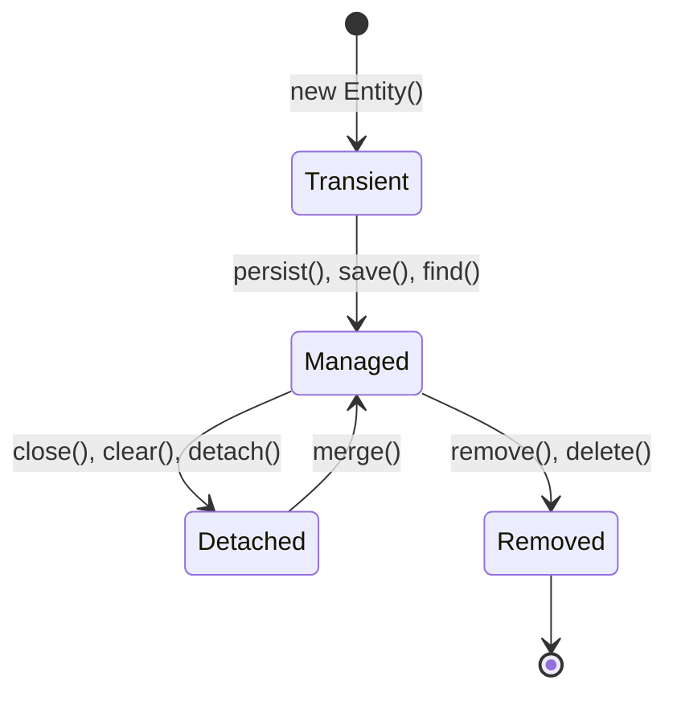

# Persistence Context

> Tag: #hibernate #jpa #persistence-context
> Ngày tạo: 2026-10-21
> Mức độ hiểu: [x] Hiểu cơ chế [ ] Đã kiểm chứng qua code [ ] Sẵn sàng phỏng vấn

---

## 1. Khái niệm & Tại sao sinh ra? (Problem & Solution)
* **Vấn đề thực tế:** Khi ứng dụng làm việc với DB, nếu mỗi lần cần thông tin lại phải query DB, hoặc nếu 1 object bị sửa ở 3 chỗ khác nhau thì gửi 3 câu update, CSDL sẽ chịu tải rất lớn và dữ liệu trong bộ nhớ có nguy cơ không đồng nhất.
* **Định nghĩa ngắn gọn:** Persistence Context là môi trường lưu trữ tạm thời trong RAM của Hibernate (First-Level Cache). Nó lưu giữ các Entity instances và theo dõi mọi thay đổi của chúng trong suốt phạm vi của một [[Hibernate-Session]].

---

## 2. 4 Trạng thái vòng đời của Entity (Entity Lifecycle)

1. **Transient (Mới tạo):** Đối tượng được tạo bằng từ khóa `new`, chưa có định danh ID trong database, chưa được Persistence Context quản lý.
2. **Managed / Persistent (Được quản lý):** Đối tượng gắn liền với một Persistence Context và có ID trong database. Mọi thay đổi trên đối tượng này sẽ được theo dõi tự động qua [[Dirty-Checking]].
3. **Detached (Tách rời):** Đối tượng từng ở trạng thái Managed nhưng Session đã bị đóng (`session.close()`) hoặc bị đẩy ra ngoài (`session.clear()`). Thay đổi trên object này sẽ **KHÔNG** tự động cập nhật xuống DB nữa.
4. **Removed (Đã xóa):** Được đánh dấu xóa bằng `session.remove()`. Sẽ bị xóa bằng câu `DELETE` khi flush.

---

## 3. Khái niệm liên quan (Knowledge Graph)
* [[Hibernate-Session]] — Session bọc lấy và sở hữu một Persistence Context.
* [[Dirty-Checking]] — Quá trình Persistence Context đối soát bản snapshot để sinh SQL.
* [[First-Level-Cache]] — Chính là bộ nhớ map lưu các Managed Entity theo ID.
* [[LazyInitializationException]] — Gặp phải khi truy cập field lazy của một entity đang ở trạng thái **Detached**.

---

## 4. Câu hỏi tự kiểm tra / Phỏng vấn
- [ ] Sự khác biệt giữa `persist()` và `merge()` là gì?
- [ ] Khi nào một entity chuyển từ `Managed` sang `Detached`?
- [ ] Tại sao không nên lưu trữ Entity ở trạng thái Detached vào HTTP Session?
