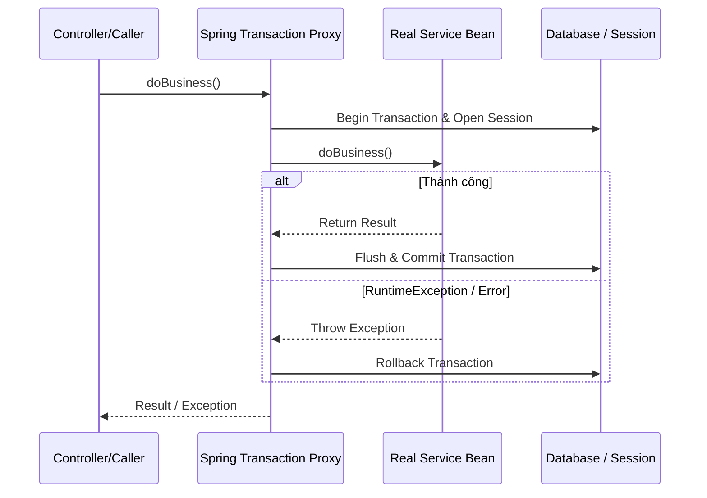

# @Transactional trong Spring Boot

> Tag: #spring #transaction #aop #backend
> Ngày tạo: 2026-10-21
> Mức độ hiểu: [x] Hiểu cơ chế [x] Đã xử lý trong dự án [ ] Sẵn sàng phỏng vấn

---

## 1. Khái niệm & Cơ chế AOP Proxy
Khi bạn đánh dấu `@Transactional` lên một method hoặc class, Spring không sửa đổi trực tiếp code của bạn. Thay vào đó:
* Spring tạo ra một **Dynamic Proxy** (CGLIB proxy) bao bọc lấy Bean của bạn.
* Khi client gọi method, cuộc gọi đi qua Proxy trước. Proxy mở Transaction và Hibernate Session, sau đó gọi method thực tế, và cuối cùng bắt exception để rollback hoặc commit.

---

## 2. Các cạm bẫy thực tế (Production Traps)
* ⚠️ **Cạm bẫy 1: Self-Invocation (Gọi nội bộ cùng class):**
  * Nếu method `a()` gọi method `b()` (có `@Transactional`) trong cùng một class `this.b()`, cuộc gọi không đi qua Proxy $\longrightarrow$ **Giao dịch hoàn toàn KHÔNG được kích hoạt!**
  * *Khắc phục:* Tách `b()` sang một Service/Component khác, hoặc tự inject bean của chính nó.
* ⚠️ **Cạm bẫy 2: Rollback mặc định:**
  * Mặc định Spring chỉ rollback với `RuntimeException` và `Error`. Nếu method ném ra `Checked Exception` (kế thừa `Exception`), Spring vẫn **COMMIT**!
  * *Khắc phục:* Luôn khai báo rõ `@Transactional(rollbackFor = Exception.class)`.

---

## 3. Khái niệm liên quan (Knowledge Graph)
* [[Hibernate-Session]] — Spring Transaction đồng bộ hóa Session trong suốt transaction.
* [[Dirty-Checking]] — Được kích hoạt khi Proxy chuẩn bị commit transaction.
* [[Transaction-ACID]] — Bản chất nguyên tử và cô lập trong database.
