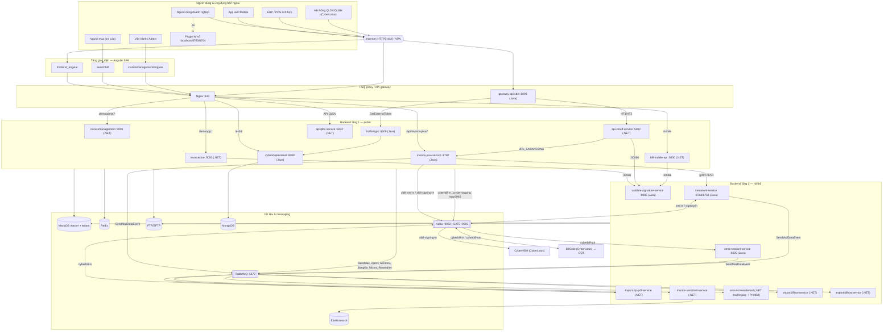
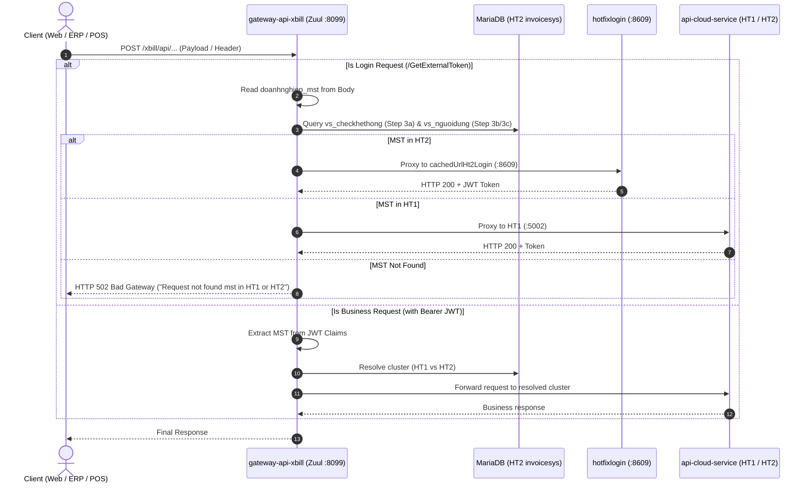
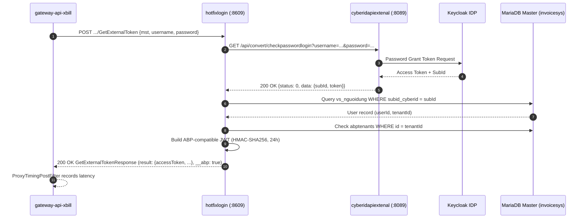
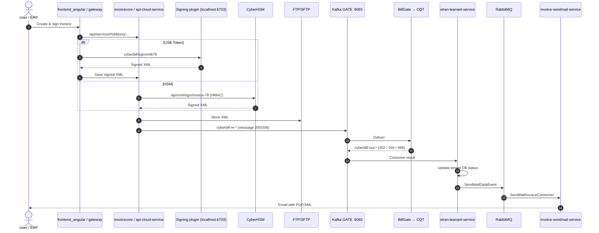

# BillCloud Architecture

## 1. Purpose

This document describes the overall system architecture of the BillCloud (xBill / CyberBill) platform workspace. It serves as the primary source of truth for developers, reviewers, and AI agents to understand system boundaries, service responsibilities, inter-service communications, routing mechanics, databases, messaging queues, and code conventions before implementing changes.

Every top-level service folder in this workspace is an independently cloned Git repository. When discrepancies occur between local READMEs, Git repository names, and actual source code, **the actual source code under each folder is treated as authoritative**.

> **Revision 2026-10-09** — re-verified against the source/config of all 18 service repositories present in the workspace (`appsettings*.json`, `application*.yml`, `App.config`, Dockerfile, K8s manifests, `.gitlab-ci.yml`, Ansible playbooks, outbound HTTP/queue code).
> **Revision 2026-10-09 (rev 2)** — Admin Cloud is modelled as `invoicemanagement` only (the separate admin-cloud checkout was deleted from the workspace and removed from the model). Outbound connections split into **(A) internal xCyber / CyberLotus services** and **(B) services outside CyberLotus** (§5.4). System configuration table `vs_dm_ncc_cauhinh` (master DB) reviewed and documented in §5.5; components found only in that table were added (CBSign SignCenter, QLBH, apicheckbill, Odoo Helpdesk, VPBank, MB Bank, Zalo OA, CA CRL/OCSP).
>
> **Revision 2026-10-09 (rev 3)** — model re-layered by network exposure: Users → Internet/VPN → UI tier → Proxy/API Gateway tier → **Backend tier 1 (public)** → **Backend tier 2 (internal)** → Data (§5.0). `bangke-dctt-java-service` and `invoice-senddata2tct-service` removed (not in use). `hotfixlogin` is an official xBill service (source now in workspace, §8.2). `xbill-signing-service` is not drawn: signing is done by **CyberHSM** (CyberLotus ecosystem) reached over Kafka `xbill-signing-in`. Direct link to TCT/CQT replaced by **BillGate** (CyberLotus ecosystem, Kafka `cyberbill-in-*` / `cyberbill-out-*`). Removed from the outbound model: unverified internal tools (`URL_DACTHU_EXCEL`, `URL_KIEMTRA_KHACHHANG_STATUS`) and the partner T-VAN RabbitMQ (`UseVAN=0`). Per-service dependency matrix added (§5.6).
>
> Companion deliverables in `docs/deploy/`:
> - `billcloud-architecture.drawio` — editable architecture diagram (open with draw.io / diagrams.net); `billcloud-architecture.png` — rendered image.
> - `TL_Thiet_ke_he_thong_BillCloud_v1.0.docx` — system design document (HLD/LLD): component list, connection matrix, internal ports, domain → service mapping, environments.
>
> Hosts/ports below are taken from the DEV/DEMO configuration committed in each repo unless stated otherwise. PROD values (systemd units, Nginx vhosts, env vars) are **not** in the repositories and must be confirmed by DevOps. No secret value is copied here — only configuration key names.

## 2. System Overview

BillCloud is a distributed, multi-tenant electronic invoice platform (Hóa đơn điện tử — HĐĐT) compliant with Decree 123/2020/NĐ-CP and Circular 78/2021/TT-BTC. It covers the full invoice lifecycle (create → sign → issue → adjust/replace/cancel → send to the tax authority → deliver to buyer → lookup/verify → report), tax-deduction documents (chứng từ khấu trừ), POS/MTT invoices, public-asset invoices (hóa đơn tài sản công) and bảng kê DCTT.

At a high level:

- **Layering (§5.0):** Users / external apps → Internet or VPN → **UI tier** (Angular SPAs served as static files) → **Proxy / API Gateway tier** (Nginx reverse proxy, `gateway-api-xbill`) → **Backend tier 1 — public** (services called by the UI or by external apps, always through the proxy tier) → **Backend tier 2 — internal** (only reachable from other xBill services, or Kafka/RabbitMQ consumers without an inbound port) → shared data & messaging.
- **Edge:** Nginx (HTTPS 443) serves the SPAs and proxies by domain/path (`demoapp.*` → `invoicecore`, `demoapp.*/api/invoice-java/*` → `invoice-java-service` — called by `frontend_angular`, `demoadmin.*` → `invoicemanagement`, mobile domain → `bill-mobile-api`, QLDV API domain → `api-qldv-service`, `accounts-api.xcyber.vn/cloud*/exbill` → `cyberidapiextenal`). ERP/POS integrations enter through **`gateway-api-xbill`** (Zuul, `:8099`, K8s NodePort `32048`) which routes `/xbill/**` to cluster HT1 or HT2 by MST / tenantId (master tables `vs_checkhethong`, `vs_nguoidung`).
- **Authentication:** ABP JWT issued by the .NET backends; `/GetExternalToken` for HT2 is routed by the gateway to **`hotfixlogin`** (xBill service, Java 21, `:8609`) which validates the password through `cyberidapiextenal` (`/exbill/api/convert/checkpasswordlogin`, Keycloak + MongoDB), looks up `vs_nguoidung` / `abptenants` in the master DB and mints the ABP-compatible JWT. Portal users can also sign in through CyberID OIDC (`accounts.xcyber.vn`, realm `cyberid`).
- **Core .NET backends (ASP.NET Zero / ABP):**
  - `invoicecore` — **main portal API** (`hddt` module, deployed as *CyberBillApp*, Kestrel `:5000`), also hosts the TraCuu lookup API used by `searchbill`.
  - `api-cloud-service` — **integration API** for ERP/POS (`hddtws` module, deployed as *CyberBillWs*, `:5002`), target of the gateway.
  - `api-qldv-service` (service/package management), `invoicemanagement` (Admin Cloud / MSP portal, `:5001`), `bill-mobile-api` (mobile backend).
- **Java services (Spring Boot):** tier 1 — `invoice-java-service` (public-asset invoices, copy, draft signing; REST `:6782`, gRPC `:6783`), `hotfixlogin` (`:8609`), `cyberidapiextenal` (`:8089`); tier 2 — `createxml-service` (TT78 XML; REST `:8760`, gRPC `:8761`), `validate-signature-service` (`:8085`, NodePort `30086`), `etran-teanant-service` (CQT message consumer, `:8600`). XML signing for the Java pipeline is done by **CyberHSM** (CyberLotus ecosystem) consuming Kafka `xbill-signing-in` — it is not an xBill service.
- **Async workers (.NET):** `export-zip-pdf-service` (PDF/ZIP, send/resend, POS mix, bảng kê), `invoice-sendmail-service` (MassTransit mail), `importbillhostservice` (queue `ImportDatas(Cloud)`), `exportbillhostservice` (queue `ExportData`) — both split out of `svinvoicesendemail` on 2026-10-09 — and `svinvoicesendemail` (remaining: legacy mail `SendMail`/`SendMailCRM`, `AppServicePrintBill` on `PrintPDFData`, XML download).
- **Messaging:** RabbitMQ `:5672` (MassTransit exchanges + direct queues) and Kafka (internal `:9092`; GATE `:9093` SASL/SCRAM carrying `xbill-xml-in`, `xbill-signing-in` (→ CyberHSM), `cyberbill-in-*`, `cyberbill-out-*`, `xcyber-logging`). The tax authority (TCT/CQT) is reached through **BillGate** (CyberLotus ecosystem): xBill exchanges `cyberbill-in-*` / `cyberbill-out-*` with BillGate over Kafka GATE, and BillGate talks to CQT.
- **Data:** MariaDB master `invoicesys(v2)` + one database per tenant (PROD via MaxScale `:4006`), Redis `:6379`, FTP/SFTP for XML/PDF/ZIP (DB stores only paths), MongoDB (CyberID ext), Elasticsearch (worker logs). System parameters and most outbound endpoint URLs live in master table `vs_dm_ncc_cauhinh` (per đại lý, cached in Redis hash `QLCAUHINH`, edited from `invoicemanagement`) — see §5.5.
- **(A) Internal xCyber / CyberLotus services:** BillGate (CQT gateway, Kafka GATE `cyberbill-in-*` / `cyberbill-out-*`), CyberID/Keycloak, xCyber UP/GDDT + BillStore (HĐ đầu vào) + HDSD, CyberHSM (Kafka `xbill-signing-in` + HMAC REST, per-enterprise), CBSign SignCenter (`KYXML_WS`/`KYPDF_WS`), QLBH/QLDV (`:8012`), MST lookup (`:8889`/`:8088`), apicheckbill (`:31501`), Odoo ERP/Helpdesk, SMTP relay `smtpx.cyberlotus.vn:587`, Gotenberg (`:30000`), XAdES verify (`:8111`). Detail §5.4.1.
- **(B) Services outside CyberLotus:** VPBank (lending OpenAPI + SFTP + iframe), MB Bank onboarding, Zalo OA, CA CRL/OCSP endpoints, customers' own SMTP servers, public links (YouTube, government eTax, Google reCAPTCHA). Detail §5.4.2.
- **Client side:** signing plugin on the user's PC (`http://localhost:6703/6704`, USB Token).

## 3. Workspace Layout

The architecture covers **19 service repositories + `docs/`** (`bangke-dctt-java-service` and `invoice-senddata2tct-service` are not in use and are no longer part of the architecture):

| Local Folder | Type / Runtime | Role in Architecture | Port (DEV config) |
|---|---|---|---|
| `gateway-api-xbill/` | Spring Cloud Zuul (Java 8) | API gateway for ERP/POS, HT1/HT2 routing by MST | `8099` (K8s NodePort `32048`) |
| `cyberidapiextenal/` | Spring Boot 2.7.5 (Java 8) | CyberID ext: password check, OTP, mail, Keycloak admin | `8089` `/exbill` |
| `hotfixlogin/` | Spring Boot 3.2.4 (Java 21) | Fast `/GetExternalToken` → ABP JWT (HT2), behind the gateway | `8609` `/api/mspservices` |
| `invoicecore/` | ASP.NET Zero/ABP + Angular + TraCuu | **Main portal API** (`hddt`), legacy portal UI and lookup UI | `5000` |
| `api-cloud-service/` | ASP.NET Zero/ABP (.NET Core 2.x) | Integration API `hddtws` (CyberBillWs) | `5002` |
| `api-qldv-service/` | ASP.NET Zero/ABP | Service/package/quota management | `5002` (separate host) |
| `invoicemanagement/` | ASP.NET Zero/ABP + Angular | Admin Cloud / MSP portal (API + UI) | `5001` (`ASPNETCORE_URLS`) |
| `bill-mobile-api/` | ASP.NET Zero/ABP (+ angular, TraCuu copies) | Mobile backend | `5000` (separate host) |
| `invoice-java-service/` | Spring Boot (Java 17) + gRPC | Public-asset invoices, copy, draft signing | `6782` HTTP, `6783` gRPC |
| `createxml-service/` | Spring Boot (Java 17) + gRPC | TT78 XML builder, Kafka `xbill-xml-in` consumer | `8760` HTTP, `8761` gRPC |
| `validate-signature-service/` | Spring Boot (Java 17) | XML/PDF signature + CRL/OCSP validation | `8085` (NodePort `30086`) |
| `etran-teanant-service/` | Spring Boot (Java 8) | CQT message consumer (`cyberbill-out-*`) | `8600` |
| `export-zip-pdf-service/` | .NET Worker (MassTransit) | PDF/ZIP, send/resend, POS mix, bảng kê consumers | — |
| `invoice-sendmail-service/` | .NET Worker (MassTransit) | Invoice email consumer, NLD sync | — |
| `importbillhostservice/` | .NET Console (`RabbitMQ.Client`) | Import worker — queue `ImportDatas(Cloud)` (split from `svinvoicesendemail/AppServiceImportBillHost`) | — |
| `exportbillhostservice/` | .NET Console (`RabbitMQ.Client`) | Export worker — queue `ExportData` (split from `svinvoicesendemail/AppServiceExportBillHost`) | — |
| `svinvoicesendemail/` | .NET Console (`RabbitMQ.Client`) | Remaining projects: legacy mail (`SendMail`, `SendMailCRM`), `AppServicePrintBill` (`PrintPDFData`), XML download | — |
| `frontend_angular/` | Angular 6 + Metronic/PrimeNG | Main enterprise portal (static on Nginx) | 80/443 |
| `searchbill/` | Angular | Public invoice lookup portal (static on Nginx) | 80/443 (`:8600` HT2 behind gateway) |
| `docs/` | Markdown | Source-of-truth documentation | — |

**Referenced in runtime flows but NOT present in this workspace** (keep in mind when tracing; do not guess their code):

| Component | Evidence | Note |
|---|---|---|
| CyberHSM signing worker (formerly modelled as `xbill-signing-service`) | Kafka topic `xbill-signing-in` produced by `invoice-java-service`/`createxml-service` | Part of the CyberLotus ecosystem (CyberHSM) — external to xBill, not drawn as an xBill service. |
| `apicheckbill` | `URL_CHECK_HE_THONG` | HT1/HT2 resolver on K8s NodePort `31501`. |
| `xbillautotest` | Previous workspace snapshot | Playwright E2E suite. |
| Consumer of `GuiTongCucThue` | Queue published by `invoicecore`, `api-cloud-service`, `api-qldv-service`, `bill-mobile-api` | No consumer found in any branch of the workspace repos — confirm whether still used. |

## 3.1 Service Repository Mapping

| Local Folder (canonical name) | Git Repository URL | Branch (snapshot 2026-10-09) | Deploy model (from CI) |
|---|---|---|---|
| `gateway-api-xbill` | `http://10.30.1.17/xBill/gateway-api-xbill.git` | `deploy/demo` | Docker → Harbor `10.30.19.132:8080/cyberbillmsp/gatewayapi` → `kubectl` ns `cyberbillcloudv1` |
| `cyberidapiextenal` | `http://10.30.1.17/cyberid/cyberidapiextenal.git` | `dev` | n/a in repo |
| `hotfixlogin` | `http://10.30.1.17/xBill/hotfixlogin.git` | `main` | n/a in repo (README still the GitLab template) |
| `invoicecore` | `http://10.30.1.17/cloudinvoicesys/invoicecore.git` | `develop_v2` | CI `deploy/pre_v2` → rar → Ansible (CyberBillApp, systemd `cyberbill`, `/opt/cyberbillapp`) |
| `api-cloud-service` | `http://10.30.1.17/xBill/api-cloud-service` | `develop_v3` | CI `deploy/dev_v3` → Ansible (CyberBillWs, systemd `cyberbillws`, `/opt/cyberbillws`) |
| `api-qldv-service` | `http://10.30.1.17/cloudinvoicesys/api-qldv-service` | `dev` | no CI file |
| `invoicemanagement` | `http://10.30.1.17/cloudinvoicesys/invoicemanagement` | `develop_cloud` | n/a in repo |
| `bill-mobile-api` | `http://10.30.1.17/xBill/bill-mobile-api` | `dev` | CI `deploy/dev` → Ansible (`/opt/cyberbillapp`) |
| `invoice-java-service` | `http://10.30.1.17/xBill/invoice-java-service` | `develop` | n/a in repo |
| `createxml-service` | `http://10.30.1.17/xBill/createxml-service` | `develop` | n/a in repo |
| `validate-signature-service` | `http://10.30.1.17/xBill/validate-signature-service` | `develop` | n/a in repo (NodePort `30086` referenced by backends) |
| `etran-teanant-service` | `http://10.30.1.17/etran/etran-teanant-service` | `develop` | K8s manifests on `deploy/staging` (ns `cyberbillmsp`, ClusterIP `8600`) |
| `export-zip-pdf-service` | `http://10.30.1.17/xBill/export-zip-pdf-service` | `develop-cloud-ls` | CI `deploy/cloud` → Ansible (systemd `bill-zippdf`, `/opt/bill-zippdf-service`) |
| `invoice-sendmail-service` | `http://10.30.1.17/cloudinvoicesys/invoice-sendmail-service.git` | `deploy/cloud/dev` | CI → Ansible (systemd `bill-sendmail-service`) |
| `importbillhostservice` | `http://10.30.1.17/cloudinvoicesys/importbillhostservice.git` | `dev_cloud`, `dev_lienson`, `dev_msp` (history of `AppServiceImportBillHost/` + root CI/K8s files) | `dev_msp`: GitLab CI → Harbor `importservicemsp` → `kubectl` ns `cyberbillmsp` |
| `exportbillhostservice` | `http://10.30.1.17/cloudinvoicesys/exportbillhostservice.git` | `dev_cloud`, `dev_lienson`, `deploy/export-msp-new`, `deploy/export-msp-packge` | `deploy/export-msp-*`: GitLab CI → Harbor `exportexcelmsp` → `kubectl` |
| `svinvoicesendemail` | `http://10.30.1.17/cloudinvoicesys/svinvoicesendemail.git` | `master` (import/export code on `dev_cloud`, `dev_msp`, `dev_lienson`, `deploy/export-msp-*` — now moved to the two repos above) | n/a in repo |
| `frontend_angular` | `http://10.30.1.17/cloudinvoicesys/frontend_angular.git` | `deploy/dev_v2` | CI → rar (without `appconfig*.json`) → Ansible → Nginx `/opt/cyberbill` |
| `searchbill` | `http://10.30.1.17/cloudinvoicesys/searchbill` | `deploy/cloud/stg` | Nginx image; K8s manifests on `deploy/cloud/stg-k8s-cloud` (ns `searchbillcloud`, NodePort `32481`) |
| `docs` | `http://10.30.1.17/xBill/docs.git` | `docs/xbill-cloud` | — |

## 4. Technology Stack

### API Gateway & Identity Stack

- **API Gateway:** Spring Cloud Netflix Zuul (Spring Boot 2.3.4, Java 8). Custom `PreFilter`, `ProxyTimingPostFilter`, `ProxyTimingErrorFilter`.
- **High-Speed Auth Gateway:** Spring Boot 3.2.4 (Java 21), Spring Data JPA, HikariCP, JJWT (io.jsonwebtoken).
- **Identity & Account Management:** Spring Boot 2.7.5 (Java 8), Keycloak Admin Client 21.1.1, Spring Data MongoDB, Redisson 3.23.3, Google Authenticator (TOTP), Spring Mail.

### Backend APIs (ASP.NET Zero / ABP)

- ASP.NET Core (.NET Core 2.1 / 3.1) / ASP.NET Zero / ABP Framework.
- Multi-tenant architecture with master DB (`invoicesys`) and tenant databases.
- Layering: `VS.*` (zero, core, application, web host) and `WS.*` (HDDT business domain).
- Entity Framework Core with MariaDB / MySQL provider (`Pomelo.EntityFrameworkCore.MySql` / `MySql.Data.EntityFrameworkCore`).
- NSwag CLI for generating TypeScript service proxies from Swagger OpenAPI endpoints.

### Specialized Java Microservices (Spring Boot & Cloud Native)

- Java 17 and Java 21 LTS runtime.
- Framework: Spring Boot 3.x / 2.7.x, Spring Data JPA, Spring Kafka, Spring Web, Spring Actuator.
- Cryptography & Signing: CyberHSM integration (HMAC-SHA256 authenticated REST), Apache XML Security (Santuario), OpenXML4J.
- Certificate Validation: CRL / OCSP verification caching, X.509 path validation.
- Database & Persistence: MariaDB / MySQL, HikariCP multi-tenant dynamic connection routing.
- Observability: Micrometer, Prometheus actuator metrics, OpenTelemetry javaagent.

### Asynchronous Workers (.NET)

- .NET Core Worker / Console Services (`bill-worker-service.sln`, `bill-sendmail-service.sln`).
- Messaging: RabbitMQ / MassTransit with `EventBus.Messages` contracts.
- Data access: Dapper (`Dapper.Core`), Entity Framework Core (`Ef.Core`), ADO.NET (`Data.Core`).
- File processing: PDF generation engines, ZIP archiving, SFTP / FTP upload via SSH.NET / FluentFTP.

### Frontend Applications

- Angular 6.x / TypeScript 2.x.
- ASP.NET Zero UI templates, Metronic theme, PrimeNG components, Bootstrap.
- ABP frontend core: `abp-ng2-module`, `abp-web-resources`.
- Dynamic runtime configuration via `AppPreBootstrap.ts` and `assets/appconfig.json`.

### Testing & Quality Assurance

- `xbillautotest` (Java 17 + Playwright, JUnit 5, Allure) is **not present in this workspace snapshot**; see §9.1.
- ABP backends keep xUnit projects under `test/VS.Tests`.

## 5. Main Runtime Architecture

> Editable diagram: `docs/deploy/billcloud-architecture.drawio` (rendered: `docs/deploy/billcloud-architecture.png`). The Mermaid view below is the same model, simplified.



The runtime architecture ensures:
1. **Two entry paths, both in the proxy tier:** browser/mobile traffic through Nginx (domain + path routing — the SPA in the UI tier calls APIs through it, e.g. `frontend_angular` → `/api/invoice-java/*` → `invoice-java-service`); ERP/POS traffic through `gateway-api-xbill`, which hides the HT1/HT2 cluster topology by resolving the MST in `vs_checkhethong` / `vs_nguoidung`.
2. **Decoupled heavy work:** XML building, HSM signing and CQT exchange run over Kafka; PDF/ZIP/mail/import/export run over RabbitMQ workers.
3. **Tenant isolation:** each tenant has its own database; services resolve the tenant connection string from the master DB per request/message (`TenantContext` in Java, ABP multi-tenancy in .NET, master lookup in workers).

### 5.0 Network Tiers (exposure model)

Layer order (top → bottom): **Users / external apps → Internet or VPN → UI tier → Proxy / API Gateway tier → Backend tier 1 (public) → Backend tier 2 (internal) → Data & messaging.** Card colour in the diagram: blue = .NET, orange = Java.

| Tier | Members | Who may call it | Exposure rule |
|---|---|---|---|
| Users / external apps | Enterprise users, buyers, operators, xBill Mobile, ERP/POS, QLDV/QLBH system (CyberLotus), signing plugin on the user PC | — | Internet (HTTPS 443) or VPN |
| UI tier | `frontend_angular`, `searchbill`, `invoicemanagement/angular` (static SPA on Nginx) | Browser | Runs in the browser; calls APIs only through the proxy tier |
| Proxy / API Gateway | Nginx reverse proxy; `gateway-api-xbill` (Java) | Internet / VPN | Only tier with an Internet-facing port (443, gateway NodePort 32048) |
| Backend tier 1 — public | .NET: `invoicecore`, `invoicemanagement` (API), `bill-mobile-api`, `api-cloud-service`, `api-qldv-service` · Java: `invoice-java-service`, `hotfixlogin`, `cyberidapiextenal` | UI tier or external apps, **always via the proxy tier** | Port open only to Nginx / gateway (and to other xBill services where listed in §5.6) |
| Backend tier 2 — internal | Java: `createxml-service`, `validate-signature-service`, `etran-teanant-service` · .NET workers: `export-zip-pdf-service`, `invoice-sendmail-service`, `importbillhostservice`, `exportbillhostservice`, `svinvoicesendemail` | Other xBill services only (HTTP/gRPC) or no inbound port (Kafka / RabbitMQ consumers) | Never exposed through Nginx or the gateway |
| Data & messaging | MariaDB, Redis, Kafka (internal + GATE), RabbitMQ, FTP/SFTP, MongoDB, Elasticsearch | Backend tiers | Internal network only (Kafka GATE `:9093` is the channel to BillGate and CyberHSM) |

### 5.1 Port & Endpoint Inventory

| Component | Listen port(s) | Exposed to Internet | Source of the value |
|---|---|---|---|
| Nginx | 80, 443 | Yes | Hosting (not in repo) |
| `gateway-api-xbill` | 8099 (NodePort 32048) | Yes (ERP/POS) | `service.yml`, `configmap.yml` |
| `hotfixlogin` | 8609 (`/api/mspservices`) | No (behind gateway) | `application.yml`, gateway `cyberbill.cloud2login` |
| `invoicecore` | 5000 | No (behind Nginx) | Kestrel default, deploy `/opt/cyberbillapp` |
| `api-cloud-service` | 5002 | No (behind gateway) | gateway `cyberbill.cloud1/cloud2` |
| `api-qldv-service` | 5002 | No | `Program.cs` (commented `UseUrls`) |
| `invoicemanagement` | 5001 | No (behind Nginx) | `ASPNETCORE_URLS`, `App:ServerRootAddress` |
| `bill-mobile-api` | 5000 | No (behind Nginx) | Kestrel default |
| `invoice-java-service` | 6782 HTTP (`/api/invoice-java`), 6783 gRPC | Path via Nginx | `application.yml` |
| `createxml-service` | 8760 HTTP (`/api/create-xml`), 8761 gRPC | No | `application.yml` |
| `validate-signature-service` | 8085 (NodePort 30086) | No | `application.properties`, backend `validateservice:xml` |
| `etran-teanant-service` | 8600 | No | `application-*.yml` |
| `cyberidapiextenal` | 8089 (`/exbill`) | Yes via `accounts-api.xcyber.vn/cloud1/exbill` | `application-dev.yml` |
| Other .NET workers | none | No | outbound only |
| MariaDB / MaxScale | 3306 / 4006 | No | `ConnectionStrings` |
| Redis | 6379 | No | `Abp:RedisCache` |
| RabbitMQ | 5672 | No | `QueueConfiguration`, `EventBusSettings` |
| Kafka | 9092 internal, 9093 SASL (GATE) | No | `Kafka:*`, `spring.kafka.*` |
| FTP / SFTP | 21 / 22 | No | `FtpConfiguration` |
| MongoDB | 27017, 27018 (replicaSet `rs`) | No | `spring.data.mongodb.uri` |
| Elasticsearch | 9200 | No | `ElasticConfiguration:Uri` |

Outbound firewall: (A) internal — 443 (CyberHSM, CyberID, xCyber UP/BillStore, Odoo), 8000 (CBSign), 8012 (QLBH), 8889/8088 (MST), 31501 (apicheckbill), 587 (SMTP relay), 9093 (Kafka GATE → BillGate, CyberHSM); (B) outside CyberLotus — VPBank OpenAPI/SFTP (`10.30.1.29:8080`, `:10022` in DEV — partner gateway), CA CRL/OCSP (80/443), customer SMTP (587/465).

### 5.2 Domain → Service Mapping

| Domain / path | Target service | Target port | Evidence |
|---|---|---|---|
| `demo.cyberbill.vn` | `frontend_angular` (static) | Nginx | cyberidapiextenal `cyberbill.url`, FE `registerUrl` redirect |
| `demoapp.cyberbill.vn` `/` | `invoicecore` | 5000 | `searchbill` `remoteServiceBaseUrl`, FE comments |
| `demoapp.cyberbill.vn` `/api/invoice-java/*` | `invoice-java-service` | 6782 | Called by `frontend_angular` (`url.constants.ts`: `TAO_HOA_DON_TS_CONG`, `KY_HSM_HOA_DON_TS_CONG`, `KY_DRAFT_XML`, `COPY_INVOICE`; base = `remoteServiceBaseUrl`) — Nginx only forwards the path |
| `demotracuu.cyberbill.vn` (PROD `tracuu.cyberbill.vn`, `tracuuhoadon.cyberbill.vn`) | `searchbill` | Nginx | `appconfig.production.json`, `LinkTraCuu` |
| `demoadmin.cyberbill.vn` | `invoicemanagement` (UI + API) | 5001 | `App:CorsOrigins` |
| `accounts-api.xcyber.vn/cloud1/exbill` | `cyberidapiextenal` | 8089 | `API_CYBERID:GET_TOKEN_API` (prod, commented) |
| PROD portal: `cloud.cyberbill.vn`, `cloud2.cyberbill.vn`; app clone `hoadonapp.cyberbill.vn` | portal / backend | — | email templates, `CorsOrigins`, `ServerRootCloneAddress` |
| ERP gateway domain, mobile API domain | `gateway-api-xbill`, `bill-mobile-api` | 8099 / 5000 | **not in repo — DevOps to confirm** |

The exact Nginx vhost/location config is not version-controlled; the mapping above is reconstructed from client configuration and must be confirmed.

### 5.3 Messaging Inventory

**Kafka**

| Topic | Producer | Consumer | Broker |
|---|---|---|---|
| `xbill-xml-in` (`-msp` suffix on MSP) | `invoice-java-service` | `createxml-service` | GATE `:9093` SASL/SCRAM-SHA-256 |
| `xbill-signing-in` (`-msp`) | `invoice-java-service`, `createxml-service` | **CyberHSM** (CyberLotus ecosystem, outside xBill) | GATE `:9093` |
| `cyberbill-in-*` (e.g. `cyberbill-in-stg`, `uat-cyberbill-in`) | `invoicecore`, `api-cloud-service`, `bill-mobile-api`, `api-qldv-service`, `export-zip-pdf-service` (bảng kê / tổng hợp) | BillGate → CQT | GATE |
| `cyberbill-out-*` (e.g. `cyberbill-out-stg`) | BillGate ← CQT | `etran-teanant-service` | GATE |
| `xcyber-logging` | .NET backends, `createxml-service` | log pipeline | GATE `:9093` |
| `InputSMS` | .NET backends, workers | SMS service (outside) | internal `:9092` |

**RabbitMQ** (`:5672`)

| Queue / exchange | Producer | Consumer |
|---|---|---|
| `SendMail` (`SendMailDemo`, `SendMailMSP`, `SendMailLienSon` per env) | `invoicecore`, `api-qldv-service`, `bill-mobile-api` | `svinvoicesendemail` |
| `SendMailCRM` | CRM | `svinvoicesendemail` (`RunCRM=1`) |
| exchange `HDDT.Application.DataTransferObjects.Services:SendMailDataEvent` (+ `SendMailOPPODataEvent`) → queue `SendMailInvoiceConsumer` | `etran-teanant-service`, `createxml-service`, `invoice-java-service`, .NET backends | `invoice-sendmail-service` |
| `ZipInvEventQueue` | `invoicecore` | `export-zip-pdf-service/ZipPdfInvConsumer` |
| `SendInvEventQueue` | `invoicecore` | `export-zip-pdf-service/SendInvConsumer` |
| `BangKeEventQueue` | `invoicecore` (bảng kê tổng hợp) | `export-zip-pdf-service/ConsumerApplication` |
| `MixInvEventQueue`, `MixInvPosEventQueue`, `ResendInvEventQueue` | `invoicemanagement`, `MixPosInvProducer` | `export-zip-pdf-service/MixPosInvConsumer`, `ResendInvConsumer` |
| `ImportDatas(Cloud)` | `invoicecore`, `api-cloud-service`, `bill-mobile-api` | `importbillhostservice` |
| `ExportData` | `invoicecore`, `api-cloud-service`, `bill-mobile-api` | `exportbillhostservice` |
| `PrintPDFData` | `invoicecore`, `bill-mobile-api` | `svinvoicesendemail/AppServicePrintBill` (`export-zip-pdf-service` only updates the print status) |
| `GuiTongCucThue` | `invoicecore`, `api-cloud-service`, `api-qldv-service`, `bill-mobile-api` | consumer not found |
| `DongBoNld`, `SearchBH` | `invoice-sendmail-service` producer | `DongBoNldApplication` |

### 5.4 Outbound Connections

Outbound connections are split into two groups. Callers were verified by searching the config key / client code in every repo; URL values come from `vs_dm_ncc_cauhinh` (master DB, DEV `invoicesysv2`) or from `appsettings*.json` / `application*.yml`.

#### 5.4.1 (A) Internal xCyber / CyberLotus services

| System | Called by | Protocol / endpoint (DEV) | Config keys |
|---|---|---|---|
| CyberID / Keycloak (xCyber Accounts) | `invoicecore`, `bill-mobile-api`, `api-qldv-service`, `invoicemanagement` (`CYBERID_WS*`), `api-cloud-service`, `invoicecore`, `bill-mobile-api` (`CYBERID_WS_KEYCLOAK`), `cyberidapiextenal` (Admin API); browser iframe đổi email/SĐT | HTTPS `stg-accounts-api.xcyber.vn`, `accounts.xcyber.vn` (OIDC realm `cyberid`), `stg-profile.xcyber.vn` | `CYBERID_WS`, `CYBERID_WS_USERNAME/PASSWORD/APPID`, `CYBERID_WS_KEYCLOAK`, `IFRAME_THAYDOITAIKHOAN`, `ENABLE_MIGRATE_CYBERID`; `Authentication:OpenId:*`, `API_CYBERID:*`, `keycloak.*` |
| xCyber UP / GDDT (gói dịch vụ, gói sản phẩm) | `invoicecore`, `bill-mobile-api`, `api-qldv-service` (server); `frontend_angular` (browser, `remoteServiceBaseUrlGDDT`, iframe) | HTTPS `dev-up-api.xcyber.vn`, iframe `dev-up.xcyber.vn/xbill/iframe/*` | `GDDT_WS`, `IFRAME_GOIDICHVU`, `IFRAME_GOISANPHAM`, `IFRAME_GDDT`, `KIEUDONGBO`, `KIEUDONGBO_DOANHNGHIEP` |
| xCyber BillStore (HĐ đầu vào / HDDV) | `invoicecore`, `bill-mobile-api` (`HDDV_API`); `frontend_angular` (`remoteServiceBaseUrlBillStore`); VPBank flow (`VPBANK_HDDV_LIST_BY_MST_URL`, API key) | HTTPS `dev-billstore.xcyber.vn` (`/api/hddv-hoa-don/internal/list-by-mst`) | `HDDV_API`, `VPBANK_HDDV_LIST_BY_MST_URL`, `VPBANK_HDDV_API_KEY` |
| xCyber HDSD (user guide) / HelpDesk iframe | browser (links returned by `invoicecore`, `bill-mobile-api`) | HTTPS `hdsd.xcyber.vn/s/bill/*` | `LINK_HDSD`, `HDSD_*`; `iFrameCreateHelpDesk`, `iFrameListHelpDesk` |
| CyberHSM / Cloud HSM (incl. the signing worker formerly modelled as `xbill-signing-service`) | REST: `invoicecore`, `api-cloud-service`, `bill-mobile-api` · Kafka: `invoice-java-service`, `createxml-service` (`xbill-signing-in`) | HTTPS REST, HMAC (pid/secret); Kafka GATE `:9093` | `ChuKySo:*` routes; base URL + credentials per enterprise in DB; `spring.kafka.producer.topic.xbill-signing-in` |
| **BillGate** — CQT gateway (the CyberLotus system that talks to the tax authority) | Kafka producers (`invoicecore`, `api-cloud-service`, `bill-mobile-api`, `api-qldv-service`, `export-zip-pdf-service`) / consumer `etran-teanant-service` | Kafka GATE SASL `:9093`, `cyberbill-in-*` (xBill → BillGate) / `cyberbill-out-*` (BillGate → xBill) | `Kafka:GATE_*`, `spring.kafka.*`, `kafka.topic.*` |
| **CBSign SignCenter** (server-side XML/PDF signing) | `invoicecore`, `api-cloud-service`, `api-qldv-service`, `bill-mobile-api`, `export-zip-pdf-service` (`KYPDF_WS`) | HTTP `:8000/cbsign/rest/signcenter/xml` and `/pdf`; per đại lý (default `125.212.234.26` — public IP over plain HTTP; đại lý 5 `10.15.11.111`) | `KYXML_WS`, `KYPDF_WS`, `VERSION_CYBERSIGN` |
| **QLBH / QLDV** (quản lý bán hàng – dịch vụ) | `invoicecore`, `bill-mobile-api`, `invoicemanagement` (`QLBH_*`); `createxml-service`, `etran-teanant-service` (xác nhận đăng ký, callback) | HTTP `10.30.1.36:8012/api/v2/cyberbill/*`, `10.30.1.47` (login), `demo.qlbh.cyberlotus.com/auto-authentication` | `QLBH_WS`, `QLBH_HOST`, `QLBH_VERIFY_PHONE`, `VERIFY_THONGTIN_DOANHNGHIEP`; `system.qldv.*`, `system.callbackapi.*`, `QLDV:HOST` |
| MST lookup | `invoicecore`, `bill-mobile-api`, `invoicemanagement` | HTTP `10.15.13.101:8889/api/tracuu/mstv2` (DB key); `:8088/api/tracuu/mst` (appsettings) | `HOST_TRACUU_MST`, `TraCuuMSTConfiguration:*` |
| **apicheckbill** (HT1/HT2 resolver) | `invoicecore`, `bill-mobile-api` | HTTP K8s NodePort `10.30.1.135:31501/apicheckbill/get-he-thong` | `URL_CHECK_HE_THONG`, `HETHONG`, `LINK_HT1_APP`, `LINK_HT2_APP` |
| **Odoo ERP / Helpdesk** | `invoicecore`, `bill-mobile-api` (gửi ticket hỗ trợ) | HTTPS `erp.ecobiz.vn/api/v1/helpdesk_ticket/cyberbill/create` (token) | `ODOO_HOST`, `ODOO_API_SEND_SUPPORT`, `ODOO_TOKEN` — *ownership of `erp.ecobiz.vn` to be confirmed* |
| SMTP relay CyberLotus | `invoicecore`, `api-cloud-service`, `api-qldv-service`, `bill-mobile-api`, `invoicemanagement`, `invoice-sendmail-service`, `svinvoicesendemail`, `cyberidapiextenal` | SMTP `smtpx.cyberlotus.vn:587`, sender `thongbao@cyberlotus.vn`; per đại lý (`MAIL_NAME` = white-label name) | `MAIL_ACCOUNT/PASSWORD/PORT/SSL/SMTP/FROM/NAME`, `SOLANGUIEMAIL`, `REPORT_EMAIL`; `spring.mail.*` |
| Gotenberg | `invoice-java-service` | HTTP `:30000/forms/chromium/convert/html` | `manual.converted.url` |
| XAdES verify | `validate-signature-service` | HTTP `:8111/xades/verify/office` | `verify.xades.url` |
| xBill internal (same platform) | `api-cloud-service`, `bill-mobile-api`, `invoicecore` → `invoice-java-service` | `URL_TAISANCONG` + `/api/invoice-java/*` | `URL_TAISANCONG` |

#### 5.4.2 (B) Services outside CyberLotus

| System | Called by | Protocol / endpoint (DEV) | Config keys |
|---|---|---|---|
| **VPBank** — vay thấu chi theo hóa đơn | `invoicecore` `VPBankLendingAppService` (per CBCLOUDV2-9335; not on the `develop_v2` checkout) + `frontend_angular` `hddt/vpbank-lending` (iframe) | OAuth2 token, `lending-info`, `init`, `invoices/analyze` via `10.30.1.29:8080` (UAT/SIT gateway); SFTP `10.30.1.29:10022` folder `lending/cyberlotus/in`; iframe `cmpuat.vpbank.com.vn`, eKYC mở TK `10.37.0.197`; payload encrypted (partner private key / VPBank public key); token cached in Redis | `VPBANK_*` (28 keys: URLs, `VPBANK_BASIC_AUTHORIZATION`, `VPBANK_CHANNEL`, token cache, invoice limits/lookback, keys, SFTP) |
| **MB Bank** — mở tài khoản | portal popup (`invoicecore`, `bill-mobile-api` return the link) | Link `mbonboard.cyberlotus.com/register` (onboarding page hosted by CyberLotus → MB Bank) | `HOST_REGISTER_MBBANK`, `MB_SOLANPOPUP` |
| **Zalo Official Account** | browser (values returned by `invoicecore`, `bill-mobile-api`) | Zalo OA widget / site verification meta | `ZALO_OAID`, `ZALO_META_CONTENT` (`ZALO_APP_ID/SECRET_KEY/REDIRECT_URI` soft-deleted) |
| **CA — CRL / OCSP** | `validate-signature-service` | HTTP(S) to URLs in the certificate (CDP / AIA) | `CRLCache`, `OCSPCache` |
| Customer SMTP servers | `invoice-sendmail-service` (per-enterprise email config) | SMTP `:587` / `:465` (Gmail, Microsoft 365, own server) | tenant email config |
| Public links | browser | YouTube (video HDSD), `xaydungchinhsach.chinhphu.vn` (xác thực sinh trắc học eTax), Google reCAPTCHA | `VIDEO78`, `HDSD_DSHDDV_VIDEO`, `LINKHDCHUYENDOI_MAU`, `LINK_XAC_THUC_SINH_TRAC_HOC`, `Recaptcha:*` |
| Client signing plugin | browser (`frontend_angular`) | HTTP `localhost:6703`, `6704` (USB Token on user PC) | `UrlConstants.API_SELF_HOST_BASE` |

### 5.5 System Configuration Table `vs_dm_ncc_cauhinh`

Master-DB table (`invoicesys` / DEV `invoicesysv2`) holding platform parameters and outbound endpoints. Columns: `cauhinh_ma` (key), `cauhinh_giatri` (value), `cauhinh_mota`, `daily_id` (`NULL` = default for all; non-null = override for an independent đại lý / white-label, e.g. `5` = Liên Sơn, `2`), ABP audit + soft delete (`isdeleted`).

- **Write path:** `invoicemanagement` → `DM_NCC_CauHinhAppService` (Admin screen *Danh mục nhà cung cấp → Cấu hình*, import Excel) → DB, then `SyncCauHinhToRedis` writes Redis hash **`QLCAUHINH`** (field = key). New consumers should read Redis `QLCAUHINH:<key>` with DB fallback (pattern used for `ACTIVE_ND_254`, CBCLOUDV2-9170).
- **Read path:** `DM_NCC_CauHinhRepository` in `invoicecore`, `api-cloud-service`, `api-qldv-service`, `bill-mobile-api`; Dapper `DmNCCCauHinhRepository` in `export-zip-pdf-service`; EF `NCC_CauHinhRepository` in `invoice-sendmail-service`; `svinvoicesendemail` (filtered by `DaiLy_Id`).

| Group | Keys | Used by |
|---|---|---|
| Nhà cung cấp / white-label | `NCC_MST`, `NCC_TENCONGTY`, `NCC_TENUNGDUNG`, `NCC_DIENTHOAIHOTRO`, `NCC_EMAILHOTRO`, `PHONE_CENTER_NUMBER` | `invoicecore`, `bill-mobile-api`, `invoicemanagement`, `export-zip-pdf-service` |
| Email | `MAIL_*`, `SOLANGUIEMAIL`, `REPORT_EMAIL` | all .NET backends, mail workers |
| Ký số server | `KYXML_WS`, `KYPDF_WS`, `VERSION_CYBERSIGN`, `NHACNHOGIAHANCTS` | backends, `export-zip-pdf-service` |
| Endpoint nội bộ xCyber/CyberLotus | `CYBERID_WS*`, `GDDT_WS`, `HDDV_API`, `IFRAME_*`, `QLBH_*`, `VERIFY_THONGTIN_DOANHNGHIEP`, `HOST_TRACUU_MST`, `URL_CHECK_HE_THONG`, `ODOO_*`, `URL_TAISANCONG`, `URL_DACTHU_EXCEL`, `URL_KIEMTRA_KHACHHANG_STATUS`, `LINK_HT1_APP`, `LINK_HT2_APP`, `LINK_HDSD`, `HDSD_*` | see §5.4.1 |
| Endpoint ngoài CyberLotus | `VPBANK_*`, `HOST_REGISTER_MBBANK`, `ZALO_*`, `LINK_XAC_THUC_SINH_TRAC_HOC`, `VIDEO78`, `HDSD_DSHDDV_VIDEO`, `LINKHDCHUYENDOI_MAU` | see §5.4.2 |
| Feature flags / limits | `ENABLE_IMPORT_SERVICE`, `ENABLE_MIGRATE_CYBERID`, `ACTIVE_HUY_HOADON`, `ACTIVE_GIOI_HAN_NGAY_KY`, `ACTIVE_KHOIPHUC_HOADON`, `ACTIVE_CHANGE_CCCD`, `NUMBER_CHANGE_CCCD`, `ACTIVE_ND_254`, `ACTIVE_MAX_BUYER_REVENUE_REPORT`, `ACTIVE_MAX_PRODUCT_REVENUE_REPORT`, `CLOUD_ACTIVE_MAX_REPORT`, `TIME_API_CHECK_TRUNG`, `OTP_EXPRIED`, `OTP_GETTIMES`, `MB_SOLANPOPUP`, `KIEUDONGBO*`, `HETHONG` | backends |
| Lịch / ngày hiệu lực | `TIME_RUN_SERVICE_POS` (POS summary schedule), `NGAYLAMTRON` (rounding cutover), `NGAY_APDUNG_SINH_TRAC_HOC` | `invoicecore`, `bill-mobile-api`, `export-zip-pdf-service` |

Review findings (DEV dump, 2026-10-09):

1. **Secrets in clear text** in the table: `MAIL_PASSWORD`, `CYBERID_WS_PASSWORD`, `ODOO_TOKEN`, `VPBANK_BASIC_AUTHORIZATION`, `VPBANK_HDDV_API_KEY`, `VPBANK_PARTNER_PRIVATE_KEY`, `VPBANK_SFTP_PASSWORD`, `CYBERID_WS_KEYCLOAK` (credentials in URL). They are also pushed to Redis `QLCAUHINH` and shown on the Admin screen → encrypt at rest / move to a secret store and mask in UI + Redis.
2. `KYXML_WS` / `KYPDF_WS` default point to a **public IP over plain HTTP** (`125.212.234.26:8000`).
3. Several keys exist in DB but **no caller is found in the checked-out branches**: `VPBANK_*` (code on a feature branch of `invoicecore`), `URL_DACTHU_EXCEL`, `URL_KIEMTRA_KHACHHANG_STATUS`, `VERIFY_THONGTIN_DOANHNGHIEP`, `LINK_HT1_APP`, `LINK_HT2_APP`, `NUMBER_CHANGE_CCCD`, `VIDEO78`, `ACTIVE_ND_254`, `ACTIVE_MAX_*_REPORT`.
4. Junk / duplicate rows: `TEST`, `test`, `test2` (active), `ABCCCCCC` (deleted), duplicate `ODOO_TOKEN`, two `CLOUD_ACTIVE_MAX_REPORT` rows (one deleted) → clean up.
5. Environment mix in one dump: `stg-accounts-api`, `dev-up-api`, `dev-billstore`, `demo.qlbh`, VPBank `uat` + `sit` paths → keep one environment per master DB and document PROD values separately.
6. `HOST_TRACUU_MST` for đại lý 5 is soft-deleted → Liên Sơn falls back to the default host; confirm intent.

### 5.6 Service Dependency Matrix (who calls whom, which data / messaging)

Values come from each repo's config and outbound code (DEV/DEMO branches, 2026-10-09). "—" = not used. External systems: (A) xCyber / CyberLotus, (B) outside CyberLotus (§5.4).

#### Tầng Proxy / API Gateway

Điểm vào duy nhất từ Internet / VPN; không chứa nghiệp vụ.

| Service | Tech · port | Called by (inbound) | Calls (xBill services) | MariaDB | Redis | Kafka | RabbitMQ | FTP / other | External |
|---|---|---|---|---|---|---|---|---|---|
| Nginx reverse proxy | Nginx · 80 / 443 | Người dùng, người mua, admin, app mobile, hệ thống QLDV/QLBH qua Internet / VPN (HTTPS 443) | Phục vụ file tĩnh frontend_angular, searchbill, invoicemanagement/angular; proxy: demoapp.* → invoicecore :5000; demoapp.*/api/invoice-java/* → invoice-java-service :6782; demoadmin.* → invoicemanagement :5001; <domain mobile> → bill-mobile-api :5000; accounts-api.xcyber.vn/cloud1\|cloud2/exbill → cyberidapiextenal :8089; <domain API QLDV> → api-qldv-service :5002 | — | — | — | — | — | — |
| `gateway-api-xbill` | Java 8 · Spring Cloud Zuul · 8099 (K8s NodePort 32048) | ERP / POS tích hợp qua Internet: /xbill/** | api-cloud-service HT1 / HT2 :5002 (theo MST trong body hoặc tenantId trong JWT); hotfixlogin :8609 (GetExternalToken của DN thuộc HT2); endpoint tra cứu HT2 cloud2tracuu (/TraThongTinHoaDon) | MariaDB master HT1 + HT2 (đọc vs_checkhethong, vs_nguoidung; danh sách tenantId HT1/HT2 cache trong bộ nhớ) | — | — | — | — | — |

#### Backend tầng 1 — Public

Được giao diện (SPA) hoặc ứng dụng bên ngoài (mobile, ERP/POS, hệ thống CyberLotus) gọi vào, luôn qua tầng proxy.

| Service | Tech · port | Called by (inbound) | Calls (xBill services) | MariaDB | Redis | Kafka | RabbitMQ | FTP / other | External |
|---|---|---|---|---|---|---|---|---|---|
| `invoicecore` | .NET · ASP.NET Zero/ABP · 5000 (Kestrel, CyberBillApp) | frontend_angular, searchbill qua Nginx (demoapp.*) | validate-signature-service (HTTP :30086 /api/validate/signature/xml); invoice-java-service (URL_TAISANCONG + /api/invoice-java/*) | Master (ABP, tenant, vs_nguoidung, vs_dm_ncc_cauhinh) + DB tenant | ABP cache, captcha tra cứu công khai, đọc hash QLCAUHINH | GATE :9093 produce cyberbill-in-* (GATE_Topic), xcyber-logging (GATE_Log_Topic); nội bộ :9092 produce InputSMS | Publish: SendMail, GuiTongCucThue, ImportDatasCloud, ExportData, PrintPDFData, ZipInvEventQueue, SendInvEventQueue, BangKeEventQueue, SendMailDataEvent | Đọc/ghi XML, PDF, ZIP | (A) BillGate (qua Kafka), CyberHSM, CBSign, CyberID/Keycloak, UP/GDDT, BillStore, QLBH, tra cứu MST, apicheckbill, Odoo, SMTP relay · (B) VPBank (nhánh tính năng), link MB Bank, Zalo OA |
| `invoice-java-service` | Java 17 · Spring Boot + gRPC · 6782 HTTP (/api/invoice-java), 6783 gRPC | frontend_angular qua Nginx (demoapp.*/api/invoice-java/*: create-invoice, send-xml-signed, sign-xml-draft, copy-invoice); api-cloud-service, invoicecore, bill-mobile-api qua URL_TAISANCONG | createxml-service (gRPC :8761); Gotenberg (HTML → PDF) | DB tenant (định tuyến động theo tenant, resolve qua master) | — | GATE :9093 produce xbill-xml-in(-msp), xbill-signing-in(-msp) | Publish exchange SendMailDataEvent / SendMailOPPODataEvent | Ghi XML / PDF | (A) Gotenberg; CyberHSM gián tiếp qua Kafka xbill-signing-in |
| `invoicemanagement (API)` | .NET · ASP.NET Zero/ABP · 5001 (ASPNETCORE_URLS) | invoicemanagement/angular qua Nginx (demoadmin.*) | — | Master (vs_dm_ncc_cauhinh, tenant, thống kê lỗi MixInv_Error / Inv_Error) + DB tenant | ABP cache; GHI hash QLCAUHINH (SyncCauHinhToRedis) | — | Publish MixInvEventQueue, ResendInvEventQueue (MassTransit) | Có cấu hình FtpConfiguration | (A) CyberID, QLBH, tra cứu MST, SMTP relay |
| `bill-mobile-api` | .NET · ASP.NET Zero/ABP · 5000 (host riêng) | App xBill Mobile qua Nginx (<domain mobile>) | validate-signature-service (:30086); invoice-java-service (URL_TAISANCONG) | Master + DB tenant | ABP cache, QLCAUHINH | GATE produce cyberbill-in-*, xcyber-logging; nội bộ InputSMS | Publish SendMail, GuiTongCucThue, Import/Export/Print | Đọc/ghi XML, PDF | (A) CyberID/Keycloak, CyberHSM, CBSign, UP/GDDT, BillStore, QLBH, tra cứu MST, apicheckbill, Odoo, SMTP relay |
| `cyberidapiextenal` | Java 8 · Spring Boot 2.7 · 8089 (/exbill) | hotfixlogin (GET /api/convert/checkpasswordlogin qua accounts-api.xcyber.vn/cloud2/exbill); client qua Nginx accounts-api.xcyber.vn/cloud1/exbill | — | — | — | — | — | MongoDB :27017/27018 (DB cyberid) | (A) Keycloak Admin API (password grant), SMTP relay |
| `api-cloud-service` | .NET · ASP.NET Zero/ABP · 5002 (CyberBillWs, mỗi cụm HT1/HT2) | gateway-api-xbill (/xbill/api/services/hddtws/*) | invoice-java-service (URL_TAISANCONG /api/invoice-java/sign-xml-draft); validate-signature-service (:30086) | Master + DB tenant | ABP cache, QLCAUHINH | GATE produce cyberbill-in-*, xcyber-logging; nội bộ InputSMS | Publish SendMail, GuiTongCucThue, ImportDatas, ExportData, PrintPDFData | Đọc/ghi XML, PDF | (A) CyberHSM, CBSign, CyberID/Keycloak, SMTP relay |
| `hotfixlogin` | Java 21 · Spring Boot 3.2 · 8609 (context /api/mspservices) | gateway-api-xbill — POST .../api/services/hddtws/Authentication/GetExternalToken của DN thuộc HT2 (cyberbill.cloud2login) | cyberidapiextenal (checkpasswordlogin, cấu hình system.cloud-check-password-url) | Master invoicesys: vs_nguoidung (theo subid_cyberid), abptenants — cấp JWT ABP (HMAC-SHA256, 24h) | — | — | — | — | — |
| `api-qldv-service` | .NET · ASP.NET Zero/ABP · 5002 (host riêng) | Hệ thống QLDV/QLBH (CyberLotus) qua Internet/VPN → Nginx (<domain API QLDV>) — đi chung tầng proxy như các bên khác; tên domain PROD cần bổ sung | — | Master + DB tenant | ABP cache, QLCAUHINH | GATE produce cyberbill-in-*; nội bộ InputSMS | Publish SendMail, GuiTongCucThue | Đọc/ghi XML, PDF | (A) CyberID, UP/GDDT, CBSign, QLDV, SMTP relay |

#### Backend tầng 2 — Nội bộ

Chỉ mở port cho service trong xBill (HTTP/gRPC nội bộ) hoặc không mở port (consumer Kafka/RabbitMQ).

| Service | Tech · port | Called by (inbound) | Calls (xBill services) | MariaDB | Redis | Kafka | RabbitMQ | FTP / other | External |
|---|---|---|---|---|---|---|---|---|---|
| `validate-signature-service` | Java 17 · Spring Boot · 8085 (K8s NodePort 30086) | invoicecore, api-cloud-service, bill-mobile-api (HTTP /api/validate/signature/xml) | — | — | — | — | — | Cache CRL / OCSP trong bộ nhớ | (A) XAdES verify :8111 · (B) CA CRL / OCSP |
| `createxml-service` | Java 17 · Spring Boot + gRPC · 8760 HTTP (/api/create-xml), 8761 gRPC | invoice-java-service (gRPC :8761); Kafka xbill-xml-in | — | DB tenant (định tuyến động) | Sequence / startValue (config.redis) | GATE: consume xbill-xml-in; produce xbill-signing-in, xcyber-logging | Publish SendMailDataEvent / SendMailOPPODataEvent | Ghi XML | (A) QLDV (system.qldv.*); CyberHSM gián tiếp qua Kafka xbill-signing-in |
| `etran-teanant-service` | Java 8 · Spring Boot 2.7 · 8600 (nội bộ, không có caller HTTP) | Kafka GATE cyberbill-out-* do BillGate trả về (kết quả CQT: 102, 202, 204, 301, 999…) | — | Master + DB tenant (định tuyến theo MST/tenant) | — | GATE: consume cyberbill-out-* (5 thread) | Publish SendMailDataEvent / SendMailOPPODataEvent | Ghi XML phản hồi CQT | (A) QLDV callback :8012 (system.callbackapi.*) |
| `export-zip-pdf-service` | .NET Worker · MassTransit · Không mở port | RabbitMQ: ZipInvEventQueue, SendInvEventQueue, ResendInvEventQueue, MixInvEventQueue, MixInvPosEventQueue, BangKeEventQueue | — | Master (resolve tenant, vs_dm_ncc_cauhinh, MixInv_Error / Inv_Error) + DB tenant | MixPosInvConsumer (Abp:RedisCache) | GATE produce cyberbill-in-* (gửi HĐ / bảng kê tổng hợp); nội bộ InputSMS | Consume các queue trên; MixPosInvProducer publish MixInvPosEventQueue | Đọc XML, ghi PDF / ZIP | (A) CBSign KYPDF_WS |
| `invoice-sendmail-service` | .NET Worker · MassTransit · Không mở port | RabbitMQ: exchange SendMailDataEvent → queue SendMailInvoiceConsumer; SearchBH / DongBoNld | — | Master (NCC_CauHinh, tenant) + DB tenant | — | — | Consume SendMailInvoiceConsumer, DongBoNld; producer SearchBH | Đọc file đính kèm PDF / XML; Elasticsearch :9200 (log) | (A) SMTP relay · (B) SMTP riêng của DN |
| `importbillhostservice` | .NET Console · RabbitMQ.Client · Không mở port | RabbitMQ queue ImportDatasCloud (ImportDatas trên MSP) do invoicecore, api-cloud-service, bill-mobile-api publish | — | Master invoicesys (resolve tenant) + DB tenant — ghi hóa đơn import | — | — | Consume ImportDatas(Cloud) | Đọc file Excel/XML import | — (repo mới cloudinvoicesys/importbillhostservice, tách từ svinvoicesendemail/AppServiceImportBillHost) |
| `exportbillhostservice` | .NET Console · RabbitMQ.Client · Không mở port | RabbitMQ queue ExportData do invoicecore, api-cloud-service, bill-mobile-api publish | — | Master invoicesys (resolve tenant) + DB tenant — đọc dữ liệu xuất | — | — | Consume ExportData | Ghi file Excel kết xuất | — (repo mới cloudinvoicesys/exportbillhostservice, tách từ svinvoicesendemail/AppServiceExportBillHost) |
| `svinvoicesendemail` | .NET Console · RabbitMQ.Client · Không mở port | RabbitMQ: SendMail / SendMailCRM (AppService — mail legacy), PrintPDFData (AppServicePrintBill) | — | Master (cấu hình mail theo DaiLy_Id) + DB tenant (in PDF) | — | — | Consume SendMail, SendMailCRM, PrintPDFData | Đọc file đính kèm; AppServiceTaiXML tải XML | (A) SMTP relay · phần import/export đã tách sang importbillhostservice / exportbillhostservice |

#### Resource usage summary

| Service | Tier | MariaDB | Redis | Kafka | RabbitMQ | FTP | MongoDB / ES |
|---|---|---|---|---|---|---|---|
| `gateway-api-xbill` | Proxy | ✔ | — | — | — | — | — |
| `invoicecore` | T1 | ✔ | ✔ | produce | publish | ✔ | — |
| `invoice-java-service` | T1 | ✔ | — | produce | publish | ✔ | — |
| `invoicemanagement` | T1 | ✔ | ✔ | — | publish | ✔ | — |
| `bill-mobile-api` | T1 | ✔ | ✔ | produce | publish | ✔ | — |
| `cyberidapiextenal` | T1 | — | — | — | — | — | MongoDB |
| `api-cloud-service` | T1 | ✔ | ✔ | produce | publish | ✔ | — |
| `hotfixlogin` | T1 | ✔ | — | — | — | — | — |
| `api-qldv-service` | T1 | ✔ | ✔ | produce | publish | ✔ | — |
| `validate-signature-service` | T2 | — | — | — | — | — | — |
| `createxml-service` | T2 | ✔ | ✔ | consume + produce | publish | ✔ | — |
| `etran-teanant-service` | T2 | ✔ | — | consume | publish | ✔ | — |
| `export-zip-pdf-service` | T2 | ✔ | ✔ | produce | consume + publish | ✔ | — |
| `invoice-sendmail-service` | T2 | ✔ | — | — | consume + publish | ✔ | ES |
| `importbillhostservice` | T2 | ✔ | — | — | consume | ✔ | — |
| `exportbillhostservice` | T2 | ✔ | — | — | consume | ✔ | — |
| `svinvoicesendemail` | T2 | ✔ | — | — | consume | ✔ | — |

## 6. Frontend Architecture

### Main Frontend: `frontend_angular/`

`frontend_angular/` is the primary Angular application. Its local README identifies it as an ASP.NET Zero Angular UI project and links to internal docs under `frontend_angular/docs/`.

Important internal docs:

- `frontend_angular/docs/index.md`
- `frontend_angular/docs/architecture.md`
- `frontend_angular/docs/features/README.md`
- `frontend_angular/docs/features/technical-overview.md`
- `frontend_angular/docs/api/api.md`

Important source areas from `frontend_angular/docs/architecture.md`:

- `frontend_angular/src/root.module.ts`: bootstrapping, session initialization, locale setup, ABP interceptor, app config.
- `frontend_angular/src/root-routing.module.ts`: root redirect and lazy loading for account flows.
- `frontend_angular/src/app/app.module.ts`: shared layout, notifications, chat, common providers.
- `frontend_angular/src/app/app-routing.module.ts`: lazy loads `hddt`, `main`, and `admin` modules.
- `frontend_angular/src/app/hddt/`: main electronic invoice feature area.
- `frontend_angular/src/app/main/`: dashboard and onboarding flows.
- `frontend_angular/src/app/admin/`: administration screens.
- `frontend_angular/src/account/`: authentication and account recovery flows.

HDDT subdomains in `frontend_angular/src/app/hddt/` include:

- `hoadon/`: outgoing invoices and related processing.
- `hddv/`: incoming or supplier invoice workflows.
- `chungtukhautruthue/`: tax deduction documents.
- `danhmuc/`: master data.
- `cauhinh/`: enterprise configuration.
- `baocao/`: reporting.
- `doanhnghiep/`: enterprise operations.
- `quanly/`: user, role, and activity management.
- `hotro/`: software, documents, and support notices.

### Frontend Backend Discovery

`frontend_angular/src/AppPreBootstrap.ts` loads runtime configuration before application start. The frontend does not rely only on compile-time backend URLs. Runtime config sets backend base URLs such as:

- `AppConsts.remoteServiceBaseUrl`
- `AppConsts.remoteServiceBaseUrlBillStore`
- `AppConsts.remoteServiceBaseUrlGDDT`

This means the same frontend bundle can point to different backend services by environment. When investigating an API call, follow the base URL assignment first, then inspect the service proxy or custom service.

### Generated Service Proxies

`frontend_angular/src/shared/service-proxies/service-proxies.ts` is generated from Swagger through NSwag. It contains many endpoints under:

- `/api/services/app/*`
- `/api/services/hddt/*`

Do not manually edit generated service-proxy output unless the project convention explicitly requires it. Prefer updating the backend API contract and regenerating proxies.

### Search Frontend: `searchbill/`

`searchbill/` is also an ASP.NET Zero Angular UI project. Its package and Angular configuration are very similar to `frontend_angular/`, but it appears focused on bill lookup/search flows.

Use `searchbill/` when a task mentions public lookup, invoice search, or standalone search UI behavior. Use `frontend_angular/` when a task mentions core portal, HDDT, administration, dashboard, configuration, or tenant/user workflows.

## 7. ASP.NET Zero / ABP Backend Architecture

### Common Layering Pattern

The ABP backend repositories (`api-cloud-service/`, `api-qldv-service/`, `invoicecore/aspnet-core/`, `invoicemanagement/`, and `bill-mobile-api/`) adhere to the standard multi-layered ASP.NET Zero / ABP architecture:

- `VS.Web.Host`: ASP.NET Core Web API host, Swagger documentation, JWT authentication, ASP.NET Core dependency injection, and health check endpoints.
- `VS.Web.Public`: Public-facing assets and landing page infrastructure.
- `VS.Web.Core`: Shared web security, authentication filters, and HTTP middleware.
- `VS.Application`: Generic ABP application services exposed under `/api/services/app/*` (users, roles, tenant settings, audit logs, background jobs).
- `VS.Application.Shared`: Data Transfer Objects (DTOs), validation interfaces, and service contracts shared between frontend and backend.
- `VS.Core`: Core domain entities (`AbpTenants`, `AbpUsers`), domain managers, and authorization permissions (`AppPermissions.cs`).
- `VS.Core.Shared`: Cross-cutting enums, constants, and shared validation rules.
- `VS.EntityFrameworkCore`: EF Core DbContext implementations, MariaDB / MySQL mapping, and repositories.
- `VS.Migrator`: Database schema migration tool.
- `WS.Application`: High-level HDDT electronic invoice application services exposed dynamically under `/api/services/hddt/*` and `/api/services/hddtws/*`.
- `WS.Core`: Invoicing domain entities (Invoices, Customers, Products, Tax Rates, Series, Templates).
- `WS.EntityFrameworkCore`: Dedicated `HDDTDbContext` mapping business tables (`vs_*`).

### `api-cloud-service/`

Integration API backend (**CyberBillWs**). Solution `VS.WS.sln`, business layer `src/hddt/WS.*` exposed under ABP module `hddtws`.
- Target of `gateway-api-xbill` for ERP/POS (`/xbill/api/services/hddtws/*`) on port `5002`, one deployment per cluster HT1/HT2.
- Invoice lifecycle for integrators: create, sign (HSM), issue, adjust/replace/cancel, send to CQT (Kafka GATE), lookup.
- Calls `invoice-java-service` for public-asset invoices (`URL_TAISANCONG` from `vs_cauhinh` + `/api/invoice-java/sign-xml-draft`) and `validate-signature-service`.
- Deployed by CI `deploy/dev_v3` → Ansible → systemd `cyberbillws` (`/opt/cyberbillws`).

### `api-qldv-service/`

The Service Provider Management (Quản lý dịch vụ) backend. Contains solution `VS.WS.sln`.
- Manages enterprise service registration, quota limits, package renewal, and tenant provisioning.
- Tracks invoice allocation balances per enterprise and ensures valid usage subscriptions before issuance.

### `bill-mobile-api/`

Dedicated backend for the xBill Mobile application.
- Located at `bill-mobile-api/aspnet-core/`.
- Exposes `/api/TokenAuth/Authenticate` and mobile-optimized invoice lookup endpoints.
- Integrates with CyberID / Keycloak for mobile user authentication.

### `invoicemanagement/`

- `invoicemanagement/` — the only Admin Cloud / MSP portal: `aspnet-core/` (API, port `5001` via `ASPNETCORE_URLS`) + `angular/` UI, domain `demoadmin.cyberbill.vn`. Publishes `MixInvEventQueue` / `ResendInvEventQueue` for error re-processing.
- Owns the system parameter screen (`DM_NCC_CauHinhAppService`): CRUD/import of `vs_dm_ncc_cauhinh` and sync to Redis hash `QLCAUHINH` (§5.5).
- Outbound: CyberID (`CYBERID_WS*`), QLBH (`QLBH_WS`), MST lookup (`HOST_TRACUU_MST`), SMTP relay (`MAIL_*`).

### `invoicecore/`

**Main portal API** (deployed as *CyberBillApp*, Kestrel `:5000`, `/opt/cyberbillapp`, systemd `cyberbill`) plus the legacy portal UI (`angular/`) and lookup UI (`TraCuu/`).
- `frontend_angular` and `searchbill` call it through `demoapp.cyberbill.vn` (`remoteServiceBaseUrl`).
- Integrations: MariaDB, Redis, FTP, RabbitMQ (`SendMail`, `ZipInv`, `SendInv`, `BangKe`, `ImportDatasCloud`, `ExportData`, `PrintPDFData`), Kafka GATE (`cyberbill-in-*`, `xcyber-logging`), `validate-signature-service`, `invoice-java-service` (`URL_TAISANCONG`).
  - (A) internal: BillGate (Kafka GATE `cyberbill-in-*` / `cyberbill-out-*`), CyberHSM (`ChuKySo:*`), CBSign SignCenter, CyberID OIDC/API, xCyber UP/GDDT + BillStore, QLBH, MST lookup, apicheckbill, Odoo Helpdesk, SMTP relay.
  - (B) outside: VPBank lending (`VPBankLendingAppService`, feature branch), MB Bank link, Zalo OA values.
- CI `deploy/pre_v2` publishes `VS.Web.Host`, removes `appsettings*.json` and ships the package via Ansible.

## 8. Java Service Architecture

BillCloud utilizes dedicated Spring Boot microservices for high-throughput, latency-critical, and cryptographic operations.

### 8.1 API Gateway: `gateway-api-xbill/`

- **Runtime:** Spring Boot 2.3.4, Java 8, Spring Cloud Netflix Zuul.
- **Port:** `8099`, routes `/xbill/**`.
- **Key Responsibilities:**
  1. **Single Entry Point:** Ingress for all external traffic destined for the invoice platform.
  2. **Dynamic Cluster Routing (`PreFilter.java`):**
     - Reads `doanhnghiep_mst` from request body (login flows) or JWT Claims (business flows).
     - Queries Database HT2 (`vs_checkhethong`) and `vs_nguoidung` (HT2, then HT1) to resolve cluster destination.
     - Routes dynamically to:
       - **HT1 Backend:** `http://10.15.12.106:5002/`
       - **HT2 Backend:** `http://10.15.12.233:5002/`
       - **HT2 Login:** `http://10.15.12.209:5002/` (for `/Authentication/GetExternalToken`)
       - **HT2 Tra Cứu:** `http://10.15.12.209:8600/`
  3. **Traffic Metrics & Latency Tracking (`ProxyTimingPostFilter.java`):**
     - Logs `gatewayDuration`, `downstreamElapsedMs`, and flags alerts for non-200 responses or proxy duration > 30s.

### 8.2 High-Speed Auth Service: `hotfixlogin/` (tier 1, Java)

- **Runtime:** Spring Boot 3.2.4, Java 21 LTS, JJWT, HikariCP; package `vn.sample.multitenancy`. Repo `xBill/hotfixlogin` (branch `main`).
- **Port:** `8609`, context path `/api/mspservices`; configured in the gateway as `cyberbill.cloud2login`. Actuator `health, info, metrics, prometheus`.
- **Endpoint:** `POST /api/services/hddtws/Authentication/GetExternalToken` (`AuthenticationController`) — body `doanhnghiep_mst`, `username`, `password`.
- **Flow (`AuthenticationService.getExternalToken`):**
  1. Call `cyberidapiextenal` `GET .../exbill/api/convert/checkpasswordlogin` (`system.cloud-check-password-url`, default `accounts-api.xcyber.vn/cloud2/exbill`) → `subId` when `status = 0`.
  2. Switch to the master DB, read `vs_nguoidung` by `subid_cyberid` → `tenantId`, `userId`.
  3. Check `abptenants` for the tenant.
  4. Build an ABP-compatible JWT (HMAC-SHA256 with `system.jwt-key`, 24 h) and return `GetExternalTokenResponse` (`__abp` format).
- **Dependencies:** `cyberidapiextenal` (HTTP), MariaDB master only (`jdbc.*`). No Redis / Kafka / RabbitMQ / FTP. Tenant routing classes exist (`MultitenantDataSource`, `VsDmNccCoSoDuLieu`) but the login flow uses the master DB only.
- Called only by `gateway-api-xbill` for enterprises on HT2; HT1 logins go to `api-cloud-service`.

### 8.3 CyberID & Identity Integration: `cyberidapiextenal/`

- **Runtime:** Spring Boot 2.7.5, Java 8 (`cyberidextenalservice`).
- **Port:** `8089`, context path `/exbill`.
- **Key Responsibilities:**
  - **Keycloak Integration:** Uses Keycloak Admin Client 21.1.1 to query users, manage required actions (e.g. `UPDATE_PASSWORD`), and obtain access tokens via Resource Owner Password Credentials Grant.
  - **Account Verification:** Exposes `/api/convert/checkpasswordlogin` to validate user credentials for external services.
  - **OTP & Email Delivery:** Generates Time-based One-Time Passwords (`TOTPService`) and sends activation/verification emails via `MailService`.
  - **Data Persistence:** Stores user profiles and organization metadata in MongoDB (`cyberid` database).

### 8.4 Tax XML Generation: `createxml-service/`

- **Runtime:** Spring Boot, Java 17. REST `:8760` (context `/api/create-xml`), gRPC server `:8761` (plaintext).
- **Key Responsibilities:**
  - gRPC/REST XML builder used synchronously by `invoice-java-service`.
  - Kafka consumer of `xbill-xml-in` (group `<topic>-group-id-<env>`, 3 threads) and producer of `xbill-signing-in` and `xcyber-logging` on the GATE cluster (SASL/SCRAM-SHA-256).
  - Builds TT78/NĐ123 XML (`DLHDon`, `NDHDon`, `TTChung`, `NBan`, `NMua`, `HHDVu`, `TToan`); tenant routing via `MultitenantDataSource`.
  - Uses Redis (`config.redis`, sequence `startValue`), FTP, RabbitMQ (`SendMailDataEvent`), QLDV (`system.qldv.*`).

### 8.5 Central Digital Signing — CyberHSM (outside xBill)

- The worker that consumes Kafka `xbill-signing-in` (produced by `invoice-java-service` and `createxml-service`) belongs to **CyberHSM** in the CyberLotus ecosystem. It is treated as an external system connected over Kafka GATE `:9093` and is not drawn as an xBill service.
- .NET backends (`invoicecore`, `api-cloud-service`, `bill-mobile-api`) call CyberHSM synchronously over HTTPS REST (HMAC) for portal/integration invoices.

### 8.6 Digital Signature Validation: `validate-signature-service/`

- **Runtime:** Spring Boot, Java 17 (`validate`). Port `8085`; backends call it at `http://<k8s-node>:30086/api/validate/signature/xml` (`validateservice:xml`).
- Validates signed XML/PDF, X.509 path, CRL/OCSP with in-memory caches (`CRLCache`, `OCSPCache`).
- Delegates Office/XAdES verification to `verify.xades.url` (`:8111`).

### 8.7 Invoice Processing Engine: `invoice-java-service/`

- **Runtime:** Spring Boot, Java 17 (`invoice-service`). REST `:6782` (context `/api/invoice-java`), gRPC `:6783`; Swagger at `/swagger-ui.html`.
- **Endpoints used by clients:** `/api/invoice-java/create-invoice`, `/send-xml-signed`, `/sign-xml-draft`, `/copy-invoice` — called by `frontend_angular` via Nginx (`demoapp.*`) and by `api-cloud-service` (`URL_TAISANCONG`).
- **Dependencies:** `createxml-service` (gRPC `:8761`), Kafka GATE (`xbill-xml-in`, `xbill-signing-in`), MariaDB tenant routing, FTP, RabbitMQ, Gotenberg (`manual.converted.url`, `:30000`).
- Uses `SaveWithTransactionService` and AOP aspects (`TenantTransactionAspect`, `ClearTenantAspect`) for multi-tenant transactions.

### 8.8 Tax Authority E-Transaction Handler: `etran-teanant-service/`

- **Runtime:** Spring Boot 2.7.x, Java 8 (`sample-multitenancy`). Port `8600`.
- Consumes `kafka.topic.default` (`cyberbill-out-*`, group `kafka.topic.default.group-id`, 5 threads) from the GATE cluster (SASL_PLAINTEXT, SCRAM-SHA-256).
- Handles message types 100/102 (registration), 200/202/204/206 (invoice send / accept / code), 300/301/302 (bảng kê), 999 (error); updates tenant DB.
- Publishes `SendMailDataEvent` / `SendMailOPPODataEvent` to RabbitMQ, writes FTP, calls QLDV callback (`system.callbackapi.*`, `:8012`).
- K8s manifests live on branch `deploy/staging` (namespace `cyberbillmsp`, Service `etranteanantservicesvc` ClusterIP `8600`).

## 9. .NET Worker Architecture

### Common Worker Pattern

The worker services use a repeated structure:

- `ProducerApplication`: publishes work messages or triggers background flows.
- `ConsumerApplication` or domain-specific consumers: consumes messages and performs work.
- `EventBus.Messages`: shared message contracts.
- `Common` and `Common.Logging`: shared utilities and logging.
- `EntityFramework/Ef.Core`, `Data.Core`, `Dapper.Core`: persistence/data access helpers.
- `Services/UpdateStatusService`: updates processing state after worker activity.

This pattern indicates asynchronous processing around invoice documents, PDF/ZIP creation, sending, resend, status update, and template operations.

### `export-zip-pdf-service/`

`export-zip-pdf-service/` contains `bill-worker-service.sln`. It includes:

- `ZipPdfInvConsumer`: consumes invoice ZIP/PDF export work.
- `SendInvConsumer`: consumes invoice sending work.
- `ResendInvConsumer`: consumes resend work.
- `MixPosInvProducer` and `MixPosInvConsumer`: producer/consumer flow for mixed POS invoice processing.
- `ConsumerApplication/BangKeConsumerApplication.csproj`: bang ke consumer application.
- `CloneMauHoaDonService`: invoice template cloning service.
- `Services/UpdateStatusService`: status update service.
- Shared event bus, data, Dapper, EF, common, and logging projects.

Use this solution when a task mentions generating or exporting invoice PDF/ZIP files, sending invoice documents, resend processing, POS invoice background processing, or worker status updates.

### `invoice-sendmail-service/`

`invoice-sendmail-service/` contains `bill-sendmail-service.sln`. It includes:

- `ConsumerApplication/SendMailConsumerApp.csproj`: email consumer.
- `ProducerApplication`: producer for email-related messages.
- `DongBoNldApplication`: synchronization application, likely related to NLD data.
- `EventBus.Messages`: message contracts.
- `EntityFramework/Ef.Core`: data access.
- `Common.Logging`: logging utilities.

Use this service when a task mentions invoice email sending, email queue processing, or mail delivery troubleshooting.

### `importbillhostservice/` and `exportbillhostservice/` (split 2026-10-09)

Both were projects of `svinvoicesendemail` (`AppServiceImportBillHost/`, `AppServiceExportBillHost/`) and are deployed as separate services. On 2026-10-09 each folder was moved to its own repo with its git history (`git filter-branch`, script `_tools/split_svinvoicesendemail.sh`); the folder path is kept so `Dockerfile` / `.gitlab-ci.yml` (`-f AppService*BillHost/Dockerfile`) work unchanged.
- `importbillhostservice` — .NET Console, `RabbitMQ.Client`; consumes `QueueName` = `ImportDatasCloud` (Cloud) / `ImportDatas`; `ConnectionStrings:default` (master) → tenant DB; FTP (`FtpUrl`). Branches `dev_cloud`, `dev_lienson`, `dev_msp` (MSP CI/K8s: image `importservicemsp`, ns `cyberbillmsp`).
- `exportbillhostservice` — .NET Console, `RabbitMQ.Client`; consumes `ExportData`; master → tenant DB; FTP. Branches `dev_cloud`, `dev_lienson`, `deploy/export-msp-new`, `deploy/export-msp-packge` (MSP CI/K8s: image `exportexcelmsp`).

### `svinvoicesendemail/` (remaining projects)

.NET Console apps using `RabbitMQ.Client` directly:
- `AppService/` — legacy mail sender: consumes `SendMail` / `SendMailMSP` / `SendMailLienSon` and optionally `SendMailCRM` (`RunCRM`), reads files from FTP, sends via SMTP.
- `AppServicePrintBill/` — consumes `PrintPDFData` (print PDF jobs).
- `AppServiceTaiXML/` — XML download worker (`TaiXMLPath`, FTP).
- `AppServiceImportBillHost/`, `AppServiceExportBillHost/` — moved to the two repos above; remove from this repo once the new pipelines are live.

### 9.1 Automated Testing Architecture: `xbillautotest/` *(not in this workspace snapshot)*

- Java 17, Playwright for Java, JUnit 5, Allure — E2E regression for login, single/batch invoice, sign & submit CQT, adjust/replace/cancel, MTT, warehouse slip, PIT certificate.
- Clone `http://10.30.1.17/xBill/xbillautotest.git` next to `docs/` when needed.

---

## 10. Integration Flows

### 10.1 North-South Gateway Dynamic Routing Flow



### 10.2 High-Performance Authentication Flow (`hotfixlogin`)



### 10.3 Circular 78 Invoice Signing & Tax Submission Flow

Two signing paths coexist. Portal / integration invoices are signed by the .NET backends; public-asset invoices go through the Java pipeline.



Public-asset (tài sản công) pipeline: `frontend_angular` (UI tier) → Nginx (proxy tier, path `/api/invoice-java/*`) → `invoice-java-service` (tier 1) → gRPC `createxml-service` (tier 2) → Kafka `xbill-xml-in` → `createxml-service` → Kafka `xbill-signing-in` → CyberHSM (CyberLotus ecosystem).

### 10.4 PDF/ZIP Export & Email Notification Flow

1. **Trigger:** `api-cloud-service` or background job schedules export or dispatch.
2. **RabbitMQ Event:** Publishes `SendMailDataEvent` or export command to RabbitMQ.
3. **Consumers:**
   - `export-zip-pdf-service`: Consumes work, loads invoice XML, renders PDF using template engine, zips files, and writes to FTP/storage.
   - `invoice-sendmail-service`: Consumes mail event, resolves tenant configuration, renders HTML email with dynamic tags, attaches PDF/XML, and transmits via configured SMTP host.
4. **Status Update:** Updates `vs_hoadon` delivery and notification status in the tenant database.

## 11. Data and Configuration Boundaries

### Databases

- **MariaDB / MySQL only** (`Pomelo`/`MySql.Data` EF Core providers in .NET, `org.mariadb.jdbc.Driver` in Java). No PostgreSQL/SQL Server is used at runtime (`appsettings.Staging.json` SQL Server strings are ASP.NET Zero template leftovers).
- Master/host DB `invoicesys` (DEV `invoicesysv2`) holds tenants, users, `vs_checkhethong`, `vs_dm_ncc_cosodulieu` (tenant connection strings, `Csdl_KetNoi`). Each tenant has its own DB with the `vs_*` business tables.
- PROD backends connect through MaxScale port `4006`; gateway reads HT1 and HT2 master DBs separately (`spring.ht1/ht2.datasource`).
- MongoDB (replicaSet `rs`, DB `cyberid`) only for `cyberidapiextenal`. Elasticsearch only for worker logging.

### Multi-Tenancy

- ABP multi-tenancy in .NET backends; Java services resolve the tenant DB via `TenantContext` / `MultitenantDataSource` (`jdbc.check-list-tenant`, `list-tenant-name`); workers look up the tenant connection string in the master DB per message.
- Gateway cluster routing (HT1/HT2) is a second isolation level on top of tenant DBs.

### Messaging

See §5.3 for the full topic/queue inventory. Rules:
- MassTransit message types are bound by full type name (e.g. `HDDT.Application.DataTransferObjects.Services:SendMailDataEvent`); Java producers set `message-type: urn:message:...` to match. Renaming a DTO namespace breaks consumers.
- Before changing asynchronous behavior, find all producers and consumers for that topic/queue.

### Runtime Configuration

- Angular: `src/assets/appconfig*.json` loaded by `AppPreBootstrap.ts`; CI excludes them from the package so each host keeps its own.
- ASP.NET Core: `appsettings.json` / `appsettings.production.json` / `appsettings-prod1*.json`; CI deletes them from the artifact — the target host provides runtime config.
- Java: `application.yml` + `application-<profile>.yml` (`dev`, `stg`); gateway uses ConfigMap `gatewayapiservice`.
- .NET console: `App.config` (`svinvoicesendemail`).
- **Database configuration:** master table `vs_dm_ncc_cauhinh` (+ Redis hash `QLCAUHINH`) holds most outbound URLs, white-label info and feature flags; tenant-level overrides live in `vs_doanhnghiep_cauhinh` / `vs_cauhinhtenant`. Changing an endpoint is a data change (deploy note required), not a code change — see §5.5.
- **Secrets are currently committed** in several of these files (DB, SASL, JWT, HSM, AMQP). Never copy them into docs; plan migration to a secret store.

## 12. Deployment Architecture

| Model | Services | Mechanism |
|---|---|---|
| VM + systemd + Nginx (Ansible) | `invoicecore` (CyberBillApp), `api-cloud-service` (CyberBillWs), `bill-mobile-api`, `export-zip-pdf-service` (`bill-zippdf`), `invoice-sendmail-service`, `frontend_angular` (static `/opt/cyberbill`) | GitLab CI `shell-linux` runner: `dotnet publish` / Angular build → `rar` → `ansible-playbook billappCloud.yml` (hosts `demo-cloud`, `resource-code`) → unrar to `/home/msp/*` → copy `/opt/*` → `systemctl restart`. Backup of `/opt/*` to `/var/backup` before deploy. Telegram/Slack notifications. |
| Kubernetes (NodePort) | `gateway-api-xbill` (ns `cyberbillcloudv1`, NodePort 32048); on deploy branches: `searchbill` (ns `searchbillcloud`, NodePort 32481), `etran-teanant-service` (ns `cyberbillmsp`, ClusterIP 8600); `validate-signature-service` (NodePort 30086, manifest not in repo) | `mvn package` / `docker build` → Harbor `10.30.19.132:8080` → `sed _dockerimage_` → `kubectl --context=k8s_dev apply` |
| Unknown from repo | `api-qldv-service`, `invoicemanagement`, `invoice-java-service`, `createxml-service`, `cyberidapiextenal`, `svinvoicesendemail`, `hotfixlogin` | No CI/manifest in current branch — DevOps to document |

## 13. How to Find the Right Source for a Task

| Task Mentions | Start Here | Then Check |
| --- | --- | --- |
| UI, screen, route, menu, validation in browser | `frontend_angular/src/app/` | `frontend_angular/src/shared/service-proxies/`, backend API service. |
| Public invoice lookup/search UI | `searchbill/` | Search API/backend mapping. |
| `/api/services/app/*` endpoint | `api-cloud-service/src/zero/VS.Application/` or `invoicecore/aspnet-core/src/zero/VS.Application/` | `VS.Web.Host`, DTOs in `VS.Application.Shared`. |
| `/api/services/hddt/*` endpoint | `api-cloud-service/src/hddt/WS.Application/` or `invoicecore/aspnet-core/src/hddt/` | frontend_angular generated proxy and HDDT domain/core projects. |
| QLDV API behavior | `api-qldv-service/` | Same `zero` and `hddt` layers. |
| PDF/ZIP invoice generation | `export-zip-pdf-service/` | Worker appsettings and queue contracts (§5.3). |
| Send invoice email | `invoice-sendmail-service/` | `EventBus.Messages`, consumer appsettings, email templates/config. |
| Import / export / print / XML download | `importbillhostservice/`, `exportbillhostservice/`, `svinvoicesendemail/AppServicePrintBill`, `svinvoicesendemail/AppServiceTaiXML` | Producers in `invoicecore` (`ImportDatasCloud`, `ExportData`, `PrintPDFData`). |
| Tax/e-transaction message type | `etran-teanant-service/` | Message-specific `ThongDiep*Service`, tenant services, XML utilities. |
| Deployment, config, scaling | Service `Dockerfile`, `deployment.yml`, `configmap.yml`, `appsettings*.json`, `application.properties` | CI/CD scripts and environment-specific overlays. |

## 14. AI Agent Working Rules

### Read First

For most tasks, inspect files in this order:

1. `docs/AGENTS.md` in the current docs branch.
2. This file: `docs/architecture.md`.
3. `docs/specs/system.md` and task-specific docs under `docs/features/`.
4. Service-local README files.
5. Service-local configuration and project files.
6. The smallest relevant source files for the requested change.

### Do Not Edit by Default

Avoid editing generated or build output unless explicitly requested:

- `target/`
- `obj/`
- `bin/`
- `node_modules/`
- `build/`
- `dist/`
- `.vs/`
- packaged `.zip` artifacts.

Avoid manual edits to generated frontend service proxies unless regeneration is not available and the project owner accepts manual patching.

### Keep Changes Local to the Responsible Service

Make the smallest service-specific change that satisfies the task. For example:

- UI-only behavior should usually stay in `frontend_angular/` or `searchbill/`.
- API contract behavior should be changed in the relevant ASP.NET application service, then reflected in generated proxies.
- Worker behavior should be changed in the matching consumer/producer solution.
- Java e-transaction behavior should be changed in the matching message or tenant service.

### Verify Before Claiming Completion

Prefer service-local verification commands:

- Angular: `npm test`, `yarn test`, `ng build`, or the package script used by that service.
- ASP.NET: `dotnet build <solution>`, `dotnet test <test project or solution>`.
- Java: `mvn test`, `mvn package`, or `./mvnw test` from the service folder.
- Kubernetes/deployment: validate YAML syntax and compare with existing deployment conventions.

If verification cannot run because dependencies or environment services are missing, report exactly what was not run and why.

## 15. Known Documentation Gaps

Closed in revision 2026-10-09: outbound connections split internal xCyber / outside CyberLotus, `vs_dm_ncc_cauhinh` review, port inventory, Kafka topics / RabbitMQ queues, external integration endpoints, domain mapping (reconstructed), deployment models.

Still open:
- Nginx vhost/location configuration and systemd units for PROD (ports of .NET hosts, path rewrite `/api/invoice-java`).
- `frontend_angular` still has `bangkedctt.service.ts` calling `/api/bkdcttservices/*` of the retired `bangke-dctt-java-service` — remove the screen/service or confirm it is hidden.
- PROD domain of the QLDV API (`api-qldv-service` is reached by the QLDV/QLBH system through Nginx like the other clients).
- Gateway `cyberbill.cloud2login` in DEV points to `:5002`, not `hotfixlogin :8609`; confirm the PROD value and the path prefix (`/api/mspservices`).
- PROD domain for the ERP gateway and mobile API; DR environment.
- Source of `apicheckbill`, `xbillautotest`; CyberHSM Kafka contract for `xbill-signing-in` (owned by CyberLotus).
- Branch holding `VPBankLendingAppService`; ownership of `erp.ecobiz.vn` (Odoo).
- PROD values of `vs_dm_ncc_cauhinh` (the reviewed dump is DEV `invoicesysv2`).
- Consumer of `GuiTongCucThue`.
- After the import/export split: CI/CD for the Cloud branches of `importbillhostservice` / `exportbillhostservice` (only MSP branches have `.gitlab-ci.yml`), and removal of the two folders from `svinvoicesendemail`.
- Sizing (CPU/RAM/disk), HA/replica counts, RTO/RPO, backup policy for MariaDB and FTP.
- Secret management (values are committed in repos).

Until these gaps are closed, verify assumptions in configuration and source before changing cross-service behavior.

## 16. Deep Dive: Frontend Applications

### `frontend_angular/` Responsibility

`frontend_angular/` is the main authenticated BillCloud / CyberBill portal. It owns the operational UI for dashboards, HDDT invoice workflows, administration, tenant/user management, configuration, reporting, support, incoming invoice integrations, bang ke flows, and tax deduction documents.

Important local documentation:

- `frontend_angular/AI_RULES.md`
- `frontend_angular/docs/index.md`
- `frontend_angular/docs/architecture.md`
- `frontend_angular/docs/api/api.md`
- `frontend_angular/docs/features/README.md`
- `frontend_angular/docs/features/technical-overview.md`

Main source map:

| Path | Responsibility |
| --- | --- |
| `frontend_angular/src/main.ts` | Angular entry point. |
| `frontend_angular/src/root.module.ts` | Root bootstrap, ABP initialization, runtime config, session init, locale setup, API base provider. |
| `frontend_angular/src/root-routing.module.ts` | Root redirect and lazy account route. |
| `frontend_angular/src/AppPreBootstrap.ts` | Loads runtime app config before normal app startup. |
| `frontend_angular/src/shared/AppConsts.ts` | Runtime constants and backend base URLs. |
| `frontend_angular/src/app/app.module.ts` | Authenticated shell module. |
| `frontend_angular/src/app/app-routing.module.ts` | Lazy routes for `hddt`, `main`, and `admin`. |
| `frontend_angular/src/app/hddt/` | Main electronic invoice business UI. |
| `frontend_angular/src/app/main/` | Dashboard, onboarding, usage guide. |
| `frontend_angular/src/app/admin/` | ASP.NET Zero admin screens. |
| `frontend_angular/src/account/` | Login, account, recovery flows. |
| `frontend_angular/src/shared/` | ABP shared utilities, helpers, generated service proxies. |
| `frontend_angular/src/services/` | Custom API wrappers for BillStore/HDDV/GDDT and axios flows. |
| `frontend_angular/src/constants/` | Route, permission, invoice, and global constants. |
| `frontend_angular/login/` | Static login assets still referenced by project docs. |

### `frontend_angular/` Routing Model

The root app redirects `/` to `/app/main/dashboard`. `/account` lazy-loads account flows. The authenticated `/app` route is guarded by `AppRouteGuard` and lazy-loads business modules.

Important route files:

- `frontend_angular/src/root-routing.module.ts`
- `frontend_angular/src/app/app-routing.module.ts`
- `frontend_angular/src/app/main/main-routing.module.ts`
- `frontend_angular/src/app/admin/admin-routing.module.ts`
- `frontend_angular/src/app/hddt/hddt-routing.module.ts`

Major route groups:

- `/app/main/dashboard`: dashboard.
- `/app/admin/users`, `/app/admin/roles`, `/app/admin/organization-units`: administration.
- `/app/hddt/danhmuc/*`: master data.
- `/app/hddt/cauhinh/*`: enterprise/system configuration.
- `/app/hddt/hoadon-*`, `/app/hddt/hoadon/*`, `/app/hddt/phieuthutien`, `/app/hddt/vemaybay`: invoice issuance and related flows.
- `/app/hddt/chungtukhautru/*`, `/app/hddt/chungtu-tao-chungtu/*`: tax deduction documents.
- `/app/hddt/baocao/*`: reports.
- `/app/hddt/bangkedctt/*`: bang ke DCTT flows.

Route metadata often contains permission names. When adding or changing screens, verify both route metadata and menu/navigation visibility.

### `frontend_angular/` Runtime Configuration

`frontend_angular/src/AppPreBootstrap.ts` loads app config from frontend assets before the application starts. It assigns values into `AppConsts`, loads ABP user configuration, then initializes session/tenant state.

Common runtime keys:

- `remoteServiceBaseUrl`: main ASP.NET Zero / ABP backend used by generated proxies.
- `remoteServiceBaseUrlBillStore`: BillStore/HDDV backend used by custom services under `frontend_angular/src/services/hddv/`.
- `remoteServiceBaseUrlGDDT`: GDDT user/service backend used by `frontend_angular/src/services/user-gddt.service.ts`.
- `appBaseUrl`: frontend app URL.
- `iFrameHddvUrl`, `iFrameHddvAppName`: HDDV iframe integration.
- `iFrameCreateHelpDesk`, `iFrameListHelpDesk`: helpdesk iframe integration.
- `loginBannerImage`, `configPopupSauKy`, `configPopupAfterLogin`: runtime UI behavior.
- `localeMappings`: localization mapping.

Do not hard-code backend URLs in components. Follow the runtime config and service wrapper conventions.

### `frontend_angular/` API Access Model

`frontend_angular/` uses two API access styles:

1. Generated NSwag proxies in `frontend_angular/src/shared/service-proxies/service-proxies.ts`.
2. Custom axios wrappers in `frontend_angular/src/services/`.

Generated proxy configuration:

- `frontend_angular/nswag/service.config.nswag`
- `frontend_angular/nswag/refresh.bat`
- Swagger source: `http://localhost:22742/swagger/v1/swagger.json`
- Output: `frontend_angular/src/shared/service-proxies/service-proxies.ts`
- Base URL token: `API_BASE_URL`

Generated proxies mainly call:

- `/api/services/app/*`
- `/api/services/hddt/*`

Custom service wrappers include:

- `frontend_angular/src/services/axios-custom.service.ts`: BillStore/HDDV base, sends `Authorization`, `doanhnghiepma`, `userma`, and `Accept-Language` headers.
- `frontend_angular/src/services/axios-ggdt-custom.service.ts`: GDDT base, sends `Authorization` and language headers.
- `frontend_angular/src/services/user-gddt.service.ts`: GDDT user endpoint access.
- `frontend_angular/src/services/hddv/*`: incoming invoice / BillStore integration.

Treat `service-proxies.ts` as generated code. Prefer backend contract change plus NSwag regeneration instead of manual edits.

### `searchbill/` Responsibility

`searchbill/` is a separate Angular ASP.NET Zero / ABP-style frontend focused on public or standalone invoice lookup and verification flows.

Use `searchbill/` for tasks mentioning:

- Public invoice lookup.
- Invoice verification by XML.
- Lookup by secret/search code.
- Tenant/domain lookup by public origin.
- Public certificate/document lookup.
- `tracuuhoadon` routes.

Main source map:

| Path | Responsibility |
| --- | --- |
| `searchbill/src/root.module.ts` | Root bootstrap and ABP setup. |
| `searchbill/src/root-routing.module.ts` | Root hash-based lookup routing. |
| `searchbill/src/tracuuhoadon/` | Main lookup module. |
| `searchbill/src/tracuuhoadon/tracuu/` | Lookup by search code and invoice viewer. |
| `searchbill/src/tracuuhoadon/xacthuc/` | XML invoice verification. |
| `searchbill/src/tracuuhoadon/thongtinchung/` | General lookup for invoice/publication/decision data. |
| `searchbill/src/tracuuhoadon/quanlyhoadon/` | Invoice list/view screens. |
| `searchbill/src/shared/service-proxies/` | Generated public lookup service proxies. |

`searchbill` uses hash routing. Root `/` redirects to `/tracuuhoadon/tracuu`, and `/tracuuhoadon` lazy-loads `TraCuuHoaDonModule`.

Important lookup services include:

- `TraCuuHoaDonServiceProxy`
- `XacThucHoaDonServiceProxy`
- `VanBanThoaThuanServiceProxy`
- `CaptchaServiceProxy`
- `TraCuuDanhSachHoaDonServiceProxy`
- `DM_NCCDomainConfigAppserviceServiceProxy`
- `NguoiDungServiceProxy`

Special behaviors:

- Captcha refresh and validation are part of lookup and XML verification.
- Domain/origin can affect tenant lookup through `getInforByLinkTraCuu(document.origin)`.
- Some flows redirect to `https://tracuuhoadon.cyberbill.vn/` as fallback.

### Frontend Build and Verification

`frontend_angular/` commands:

```bash
npm start
npm run hmr
npm run build
npm run publish
npm test
npm run e2e
```

`searchbill/` commands:

```bash
npm start
npm run hmr
npm run publish
npm test
npm run e2e
```

Frontend cautions:

- Angular 6 / TypeScript 2 is a legacy stack.
- Global scripts and styles in `angular.json` are part of runtime behavior.
- ABP globals, jQuery plugins, Metronic assets, permissions, tenant context, and localization are significant.
- `frontend_angular/build/`, `dist/`, and `node_modules/` are generated/dependency folders and should not be edited.

## 17. Deep Dive: ASP.NET Zero / ABP Backends

### Backend Repository Variants

The workspace contains three ASP.NET Zero / ABP backend variants:

| Path | Solution | Runtime | Business Prefix | Business Module |
| --- | --- | --- | --- | --- |
| `api-cloud-service/` | `VS.WS.sln` | ASP.NET Core 2.2 | `/api/services/hddtws/*` | `WS.*` |
| `api-qldv-service/` | `VS.WS.sln` | ASP.NET Core 2.2 | `/api/services/hddtws/*` | `WS.*` |
| `invoicecore/aspnet-core/` | `VS.Web.sln` | ASP.NET Core 3.1 | `/api/services/hddt/*` | `HDDT.*` |

All three follow the ASP.NET Zero / ABP modular monolith pattern. `api-cloud-service/` and `api-qldv-service/` are close variants. `invoicecore/aspnet-core/` is broader and newer, with `HDDT.DapperCore` and more business modules.

### Standard `VS.*` Layering

| Project | Responsibility |
| --- | --- |
| `VS.Web.Host` | Main HTTP API host, startup, authentication, Swagger, CORS, SignalR, Redis, RabbitMQ/MassTransit bootstrapping. |
| `VS.Web.Public` | Public-facing MVC/web resources. |
| `VS.Web.Core` | Shared web infrastructure and dynamic app-service controller registration. |
| `VS.Application` | Standard ASP.NET Zero app services: users, roles, tenants, settings, notifications, chat, audit logs. |
| `VS.Application.Shared` | Shared DTOs and app-service interfaces. |
| `VS.Core` | Domain layer for identity, authorization, tenancy, settings, and core entities. |
| `VS.Core.Shared` | Shared constants, enums, localization, DTO abstractions. |
| `VS.EntityFrameworkCore` | EF Core DbContext, repositories, seeds, database configuration. |
| `VS.Migrator` | Console entry point for migrations and seeding. |

Standard ASP.NET Zero app services are exposed by ABP dynamic controllers under:

```text
/api/services/app/{ServiceName}/{MethodName}
```

Examples include user, role, tenant, session, notifications, caching, audit log, and account services.

### Business Modules: `WS.*` and `HDDT.*`

`api-cloud-service/` and `api-qldv-service/` use:

- `WS.Application`
- `WS.Core`
- `WS.EntityFrameworkCore`

These modules expose business services under:

```text
/api/services/hddtws/{ServiceName}/{MethodName}
```

Important app-service folders:

- `Authentication`
- `Authorization`
- `BaoCao`
- `CauHinh`
- `DanhMuc`
- `Dashboard`
- `DoanhNghiep`
- `HoaDon`
- `HoTro`
- `QuanLy`
- `Services`
- `ThongTinNguoiDung`

Representative app services:

- `HoaDonAppService`
- `GuiHoaDonAppService`
- `GuiHoaDonV2AppService`
- `QuanLyHoaDonAppService`
- `TraCuuHoaDonAppService`
- `XacThucHoaDonAppService`
- `VanBanThoaThuanAppService`
- `TCTAppService`
- `SendThueAppService`
- `SendMailAppService`
- `QuanLyTenantAppService`

`invoicecore/aspnet-core/` uses:

- `HDDT.Application`
- `HDDT.Core`
- `HDDT.EntityFrameworkCore`
- `HDDT.DapperCore`

It exposes business services under:

```text
/api/services/hddt/{ServiceName}/{MethodName}
```

Additional business folders include:

- `BangKeDCTT`
- `ChungTuKhauTruThue`
- `DangKyCyberBill`
- `ExportBill`
- `HoSo`
- `KhuyenMai`
- `PrintPDF`
- `TongCucThue`

### Backend Startup and Dynamic Controllers

Important startup files:

- `api-cloud-service/src/zero/VS.Web.Core/VSWebCoreModule.cs`
- `api-cloud-service/src/zero/VS.Web.Host/Startup/Startup.cs`
- `api-qldv-service/src/zero/VS.Web.Core/VSWebCoreModule.cs`
- `api-qldv-service/src/zero/VS.Web.Host/Startup/Startup.cs`
- `invoicecore/aspnet-core/src/zero/VS.Web.Core/VSWebCoreModule.cs`
- `invoicecore/aspnet-core/src/zero/VS.Web.Host/Startup/Startup.cs`

`api-cloud-service/` and `api-qldv-service/` use ASP.NET Core 2.2 patterns such as `UseMvc`. `invoicecore/aspnet-core/` uses ASP.NET Core 3.1 endpoint routing with `UseRouting` and `UseEndpoints`. Do not copy startup or middleware code blindly between these variants.

### Explicit Backend Controllers

In addition to ABP dynamic application services, explicit controllers exist in `VS.Web.Core` and `VS.Web.Host`.

Important controllers include:

- `TokenAuthController.cs`
- `FileController.cs`
- `ProfileControllerBase.cs`
- `TenantCustomizationController.cs`
- `ChatControllerBase.cs`
- `HomeController.cs`
- `AntiForgeryController.cs`

Typical auth endpoints follow the ASP.NET Zero pattern:

```text
/api/TokenAuth/Authenticate
/api/TokenAuth/ExternalAuthenticate
/api/TokenAuth/RefreshToken
```

Verify exact routes in controller attributes before documenting or consuming them.

### Backend Configuration Surface

Important sections in `appsettings*.json`:

| Section | Purpose |
| --- | --- |
| `ConnectionStrings:Default` or `ConnectionStrings:DefaultConnection` | Main database connection. |
| `Abp:RedisCache` | Redis cache host, password, DB, timeout. |
| `App` | Server root, client root, CORS origins. |
| `Authentication:JwtBearer` | JWT issuer, audience, signing key. |
| `Authentication:OpenId` | CyberID/OpenID integration. |
| `FtpConfiguration` | FTP/file storage for invoice artifacts. |
| `QueueConfiguration` | RabbitMQ queues and credentials. |
| `Kafka` | Kafka bootstrap, topics, app IDs, tax gateway credentials. |
| `ChuKySo` | Digital signature/HSM API paths. |
| `FixedTenantConfiguration` | Forced tenant context in some deployments. |
| `FixedMSTTraCuuConfiguration` | Fixed lookup tax-code behavior. |
| `QLDV` | QLDV external service integration. |
| `Recaptcha` | Recaptcha keys. |

Treat all appsettings as sensitive. Many config files contain live-looking credentials and internal endpoints. Architecture docs should describe keys, not values.

### Backend Build and Verification

Common commands:

```powershell
dotnet build "D:\Source\billcloud\api-cloud-service\VS.WS.sln"
dotnet run --project "D:\Source\billcloud\api-cloud-service\src\zero\VS.Web.Host\VS.Web.Host.csproj"
dotnet run --project "D:\Source\billcloud\api-cloud-service\src\zero\VS.Migrator\VS.Migrator.csproj"
dotnet test "D:\Source\billcloud\api-cloud-service\test\VS.Tests\VS.Tests.csproj"

dotnet build "D:\Source\billcloud\api-qldv-service\VS.WS.sln"
dotnet run --project "D:\Source\billcloud\api-qldv-service\src\zero\VS.Web.Host\VS.Web.Host.csproj"
dotnet run --project "D:\Source\billcloud\api-qldv-service\src\zero\VS.Migrator\VS.Migrator.csproj"
dotnet test "D:\Source\billcloud\api-qldv-service\test\VS.Tests\VS.Tests.csproj"

dotnet build "D:\Source\billcloud\invoicecore\aspnet-core\VS.Web.sln"
dotnet run --project "D:\Source\billcloud\invoicecore\aspnet-core\src\zero\VS.Web.Host\VS.Web.Host.csproj"
dotnet run --project "D:\Source\billcloud\invoicecore\aspnet-core\src\zero\VS.Migrator\VS.Migrator.csproj"
dotnet test "D:\Source\billcloud\invoicecore\aspnet-core\test\VS.Tests\VS.Tests.csproj"
```

Some test project references appear stale relative to current folder layout. Verify tests before relying on them as authoritative.

## 18. Deep Dive: Java Services

### Common Java Architecture

`etran-teanant-service/` (Java 8) and `hotfixlogin/` (Java 21) use root package `vn.sample.multitenancy` with master / tenant database routing.

Shared traits:

- Spring Boot 2.7.x.
- Java 8.
- Spring Web and Spring Data JPA.
- MariaDB and PostgreSQL drivers.
- Spring Kafka and Spring AMQP.
- Hikari-backed dynamic data sources.
- Tenant routing through `TenantContext`.
- Repository/service/controller layering.
- Vietnamese e-invoice and electronic tax-message domain models.

Both services share the same Maven identity:

```xml
<groupId>vn.sample.multitenancy</groupId>
<artifactId>sample-multitenancy</artifactId>
```

This identity is misleading because the services have different production responsibilities.

### Java Multi-Tenancy Pattern

Important files:

- `*/src/main/java/vn/sample/multitenancy/multitenancy/MultitenantConfiguration.java`
- `*/src/main/java/vn/sample/multitenancy/multitenancy/MultitenantDataSource.java`
- `*/src/main/java/vn/sample/multitenancy/multitenancy/TenantContext.java`
- `*/src/main/java/vn/sample/multitenancy/service/DatabaseSessionManager.java`

Runtime model:

1. Startup loads tenant connection metadata from master database.
2. Tenant connection info is cached.
3. A `HikariDataSource` is created per tenant.
4. `AbstractRoutingDataSource` chooses database using `TenantContext`.
5. Services explicitly switch current tenant before repository calls.

Safe tenant-switching pattern:

```java
databaseSessionManager.resetCurrentTenant(BillVariable.TENANT_ID_MASTER);
try {
    // master lookup
    databaseSessionManager.resetCurrentTenant(String.valueOf(tenantId));
    // tenant work
} finally {
    databaseSessionManager.clearTenant();
}
```

Missing `clearTenant()` can leak tenant context across requests or Kafka worker threads.

### `etran-teanant-service/`

`etran-teanant-service/` processes inbound electronic tax/e-transaction XML messages. It consumes Kafka payloads, determines message type, switches to the correct tenant DB, updates tenant/master records, and calls external integrations when needed.

Important files:

- `etran-teanant-service/src/main/java/vn/sample/multitenancy/SampleMultitenancyApplication.java`
- `etran-teanant-service/src/main/java/vn/sample/multitenancy/kafka/MultiPartitionMessageConsumer.java`
- `etran-teanant-service/src/main/java/vn/sample/multitenancy/kafka/MultiPartitionMessageProducer.java`
- `etran-teanant-service/src/main/java/vn/sample/multitenancy/service/ProcessService.java`
- `etran-teanant-service/src/main/java/vn/sample/multitenancy/service/EtranService.java`
- `etran-teanant-service/src/main/java/vn/sample/multitenancy/RabbitService/RabbitProducer.java`

Main message services:

- `ThongDiep102Service`
- `ThongDiep103Service`
- `ThongDiep104Service`
- `ThongDiep110Service`
- `ThongDiep111Service`
- `ThongDiep202Service`
- `ThongDiep204Service`
- `ThongDiep213Service`
- `ThongDiep301Service`
- `ThongDiep302Service`
- `ThongDiep999Service`

Important HTTP/debug endpoints:

- `POST /api/ttd204`
- `GET /api/get-all-tenant`
- `GET /api/get-hd`
- `POST /api/insertorupdateuser`
- Several `/api/test-*` endpoints under test/debug controller.

Kafka boundary:

- Active listener uses `@KafkaListener` with `${kafka.topic.default}` and `${kafka.topic.default.group-id}`.
- Payload is passed asynchronously to `processService.processStringXml(payload)`.
- Additional tenant/topic listeners exist but are commented out.

RabbitMQ boundary:

- `EtranService.sendEmail(...)` sends MassTransit-style email events to configured exchanges.
- Config keys include `spring.rabbitmq.exchange-default`, `spring.rabbitmq.exchange-oppo`, and `spring.rabbitmq.message-type`.

External HTTP boundary:

- QLDV confirmation endpoint.
- TK01 callback endpoint.
- Invoice callback endpoint.
- Controlled by `system.*` configuration keys.

FTP boundary:

- `utils/FTPUtils.java` handles FTP access for XML/template/file operations.

Deployment:

- Docker base image: `amazoncorretto:8`.
- Container port: `8600`.
- Kubernetes namespace: `cyberbillcloudv1`.
- Deployment: `etranteanantservicedeployment`.
- Service: `etranteanantsvc`, NodePort `30175`.
- HPA exists but `minReplicas` and `maxReplicas` are both `1`.

## 19. Deep Dive: .NET Worker and App Services

### Worker Architecture Patterns

The .NET worker services use two distinct messaging patterns.

MassTransit + RabbitMQ:

- `export-zip-pdf-service/`
- `invoice-sendmail-service/`

Direct `RabbitMQ.Client` polling:

- `importbillhostservice/`
- `exportbillhostservice/`
- `svinvoicesendemail/`

MassTransit projects define event contracts in `EventBus.Messages`, register consumers in `Startup.cs`, and configure RabbitMQ receive endpoints using queue names from `EventBusSettings`.

Direct RabbitMQ projects declare queues manually, set `BasicQos`, poll with `BasicGet`, process synchronously, and acknowledge with `BasicAck`.

### `export-zip-pdf-service/`

Primary solution:

- `export-zip-pdf-service/bill-worker-service.sln`

Important projects:

| Project | Responsibility |
| --- | --- |
| `ZipPdfInvConsumer` | Consumes `ZipInvDataEvent`, creates invoice/chung tu PDFs, creates ZIP output, updates print status. |
| `ConsumerApplication` | Bang ke/tax summary consumer, generates XML, signs XML, uploads FTP, produces Kafka/GATE payload. |
| `ProducerApplication` | Test/manual API for publishing queue messages. |
| `ResendInvConsumer` | Resend and mix invoice queue processing. |
| `SendInvConsumer` | Invoice send event processing. |
| `MixPosInvProducer` | Scheduled POS invoice mix producer. |
| `MixPosInvConsumer` | Consumes POS mix events and produces tax/GATE payloads. |
| `CloneMauHoaDonService` | Invoice template clone service. |
| `Services/UpdateStatusService` | Updates worker processing status. |
| `EventBus.Messages` | Shared RabbitMQ/MassTransit event contracts. |
| `Common` | FTP, PDF, XML, Kafka, signing, invoice utilities. |
| `Dapper.Core` | Dapper repositories and unit of work. |
| `Data.Core` | Shared entities and data models. |
| `EntityFramework/Ef.Core` | EF Core data access. |

Key event contracts:

- `ZipInvDataEvent`
- `SendInvoiceDataEvent`
- `ResendInvEventQueue`
- `MixInvEventQueue`
- `MixPosInvEvent`
- `BangKeEventQueue`
- `Queue_DongBoNldInput`

Common queue names:

- `ZipInvEventQueue`
- `BangKeEventQueue`
- `ResendInvEventQueue`
- `MixInvEventQueue`

Data model:

- Master/default DB stores tenant metadata and connection strings.
- Tenant DB stores invoices, print jobs, bang ke records, service-tax rows, transaction logs, and service status.
- Dapper is dominant for ZIP/PDF and bang ke flows.

### `invoice-sendmail-service/`

Primary solution:

- `invoice-sendmail-service/bill-sendmail-service.sln`

Important projects:

| Project | Responsibility |
| --- | --- |
| `ConsumerApplication` | Main `SendMailDataEvent` consumer. |
| `ProducerApplication` | Test/manual publisher for send-mail events. |
| `DongBoNldApplication` | NLD synchronization consumer. |
| `EventBus.Messages` | Message contracts. |
| `EntityFramework/Ef.Core` | EF Core repositories/entities for invoice, mail, tenant, and template data. |
| `Common.Logging` | Serilog/Elasticsearch logging helpers. |

Main send-mail flow:

1. Consume `SendMailDataEvent` from RabbitMQ queue `SendMailInvoiceConsumer`.
2. Resolve tenant connection string from master/default DB.
3. Open tenant `InvoiceDbContext`.
4. Load invoice/chung tu/bang ke data, business config, templates, FTP file data, and lookup links.
5. Build body and attachments.
6. Send email.
7. Update service/mail status.

Supported email types include bang ke DCTT, chung tu, forgot password, and standard invoice email.

### `svinvoicesendemail/`

Remaining projects: `AppService/` (legacy mail), `AppServicePrintBill/` (`PrintPDFData`), `AppServiceTaiXML/` (XML download). Import / export moved to `importbillhostservice/`, `exportbillhostservice/`. See §9.

.NET worker verification commands (run from the workspace root):

```bash
dotnet build export-zip-pdf-service/bill-worker-service.sln
dotnet build invoice-sendmail-service/bill-sendmail-service.sln
dotnet build svinvoicesendemail/AppService/AppService.sln
dotnet build svinvoicesendemail/AppServiceTaiXML/AppService.sln
```

## 20. Deep Dive: Deployment and Runtime Configuration

### Deployment Models

See §12 for the current matrix. Notes on Kubernetes manifests: in the checked-out branches only `gateway-api-xbill` keeps `deployment.yml` / `service.yml` / `configmap.yml`; the manifests of `searchbill` and `etran-teanant-service` live on their deploy branches.

### Kubernetes Inventory

| Component | Branch holding manifest | Namespace | Service | Port | Replicas |
| --- | --- | --- | --- | --- | --- |
| `gateway-api-xbill` | `deploy/demo` (current) | `cyberbillcloudv1` | `gatewayapisvc` | `8099`, NodePort `32048` | 1 (req 200m/1Gi, limit 1 CPU/4Gi) |
| `searchbill` | `origin/deploy/cloud/stg-k8s-cloud` | `searchbillcloud` | `searchbillsvc` | `80`, NodePort `32481` | 1 |
| `etran-teanant-service` | `origin/deploy/staging` | `cyberbillmsp` | `etranteanantservicesvc` | `8600` ClusterIP | 1 |
| `validate-signature-service` | not in repo | — | — | NodePort `30086` (from backend config) | — |

### Kubernetes Image Template Pattern

Kubernetes deployments use `_dockerimage_` placeholders. CI replaces this placeholder with `sed` before `kubectl apply`.

Files using this pattern:

- `gateway-api-xbill/deployment.yml` (current branch)
- `searchbill/deployment.yml`, `etran-teanant-service/deployment.yml` (deploy branches only)

Risks:

- Runner workspace reuse can leave stale image names.
- Repository manifests are templates, not directly deployable as-is.
- Local validation can be misleading unless `_dockerimage_` is substituted.

Better future options include Helm, Kustomize, generated temporary manifests, or `kubectl set image`.

### Runtime Config Boundaries

.NET Ansible-packaged services:

- CI publishes binaries.
- CI removes `appsettings*.json` from artifacts.
- Target host is expected to provide runtime config outside the package.

Frontend packages:

- `frontend_angular` CI removes runtime appconfig files before packaging.
- `searchbill` bakes appconfig files into the image, then Kubernetes mounts NFS over `/usr/share/nginx/html/assets/appsetting/`.

Spring service:

- Dockerfile expects `/opt/source/docker/application.properties`.
- Repo ConfigMap provides `application.yml`.
- Deployment does not mount the ConfigMap.
- Effective runtime config source is ambiguous from repository files alone.

Kubernetes config caveats:

- No `Ingress` manifests were found.
- Services use `NodePort`.
- Some service manifests omit `metadata.namespace`, relying on `kubectl -n`.
- `etran-teanant-service` mounts host `/etc/localtime`.

### Deployment Risks

Important risks to track:

- Secrets are committed in multiple appsettings and Spring config files.
- `gateway-api-xbill`: Zuul `connect-timeout-millis`/`socket-timeout-millis` = 180,000,000 ms (~50 h) while the comment says 10 s/60 s; actuator exposes `*`.
- Most services run a single replica / single systemd instance; no HA evidence in repo.
- `CorsOrigins` contains `*` in .NET backends.
- `_dockerimage_` replacement mutates manifests in CI.
- `etran-teanant-service/configmap.yml` is not mounted by the visible deployment manifest.
- `etran-teanant-service` HPA cannot scale because max replicas is `1`.
- `autoscaling/v2beta2` appears in some manifests and may be unsupported by newer Kubernetes clusters.
- Several runtimes are old or end-of-life: .NET Core 2.1/3.1, Angular 6, Java 8, older Node/Nginx images.
- NodePorts are hardcoded and likely referenced outside the repository.

## 21. Deep Dive: End-to-End Business Flows

### Invoice Issuance Flow

1. User works in `frontend_angular/src/app/hddt/hoadon/` or related HDDT routes.
2. Component calls generated proxy or custom service.
3. Main backend endpoint is under `/api/services/hddt/*`, `/api/services/hddtws/*`, or `/api/services/app/*` depending on deployment mapping.
4. Backend validates tenant/user/permission context through ABP.
5. Backend writes invoice domain data to EF Core/Dapper-backed database.
6. Backend may enqueue background work for PDF, email, tax sending, resend, or bang ke processing.
7. Worker consumes the queue, resolves tenant DB, processes files/XML/PDF/email, and updates status.
8. frontend_angular polls or reloads status through API.

### Public Lookup Flow

1. User opens `searchbill` route under `/tracuuhoadon`.
2. App reads runtime backend base URL.
3. Lookup component resolves domain/tenant where needed.
4. User enters captcha and lookup key.
5. Generated proxy calls public lookup app service.
6. Backend returns invoice, document, or verification data.
7. Some flows fallback to `https://tracuuhoadon.cyberbill.vn/`.

### PDF/ZIP Flow

1. API creates print/export job and publishes `ZipInvDataEvent`.
2. `ZipPdfInvConsumer` consumes queue message.
3. Worker resolves tenant connection through master DB.
4. Worker creates invoice/chung tu PDF data.
5. Worker renders PDF using shared PDF utilities and native renderer dependencies.
6. Worker creates ZIP output where required.
7. Worker stores files through FTP/local configured storage.
8. Worker updates `ServicePrintPDF` status, path, and execution time.

### Send-Mail Flow

1. API or worker publishes `SendMailDataEvent`.
2. `invoice-sendmail-service/ConsumerApplication` consumes the message.
3. Consumer resolves tenant DB using `TenantId`.
4. Handler loads invoice/chung tu/bang ke data, business info, templates, and file attachments.
5. Email is sent through configured mail infrastructure.
6. Status is updated for retry/reporting.

### Tax Message Flow

1. Kafka topic receives XML payload.
2. `etran-teanant-service` listener consumes payload.
3. `ProcessService` parses message type.
4. Message is dispatched to `ThongDiepXXXService`.
5. Service resolves master/tenant data.
6. Service updates tenant invoice/tax/bang ke records.
7. Service calls QLDV/callback/FTP/RabbitMQ where required.

## 22. Deep Dive: AI Agent Playbooks

### UI Change Playbook

1. Identify whether the UI is in `frontend_angular/` or `searchbill/`.
2. Find route in routing module.
3. Find component and template.
4. Check route permissions and menu/navigation visibility.
5. Trace data calls to generated proxy or custom service.
6. Check runtime base URL selection in `AppPreBootstrap.ts`.
7. If backend contract changes, update backend first and regenerate proxies.
8. Verify with Angular build/test command appropriate to the app.

### Backend API Change Playbook

1. Determine endpoint prefix: `/api/services/app`, `/api/services/hddtws`, or `/api/services/hddt`.
2. Find corresponding app service under `VS.Application`, `WS.Application`, or `HDDT.Application`.
3. Check DTOs in `Application.Shared` or local app-service folders.
4. Check domain entities in `Core` and persistence in `EntityFrameworkCore` or `DapperCore`.
5. Update permissions/authorization provider if the API requires access control.
6. Verify Swagger/proxy implications.
7. Build the specific solution.

### Worker Change Playbook

1. Identify event/queue name.
2. Find message contract in `EventBus.Messages` or direct RabbitMQ DTO.
3. Find producer and all consumers before changing contract shape.
4. Verify tenant DB resolution path.
5. Check file/FTP/signing/Kafka side effects.
6. Build the specific solution/project.
7. If no tests exist, document manual verification requirements.

### Java Service Change Playbook

1. Identify whether task belongs to tax message processing or bang ke DCTT.
2. For tax messages, start at `ProcessService` and message-specific `ThongDiepXXXService`.
3. For bang ke, start at `BangKeController`, `VsBangkeService`, `DownloadService`, or `TraCuuService`.
4. Verify tenant switching and `clearTenant()` behavior.
5. Check Kafka/RabbitMQ/FTP/HSM/Redis boundaries.
6. Run Maven package/test command from service root.

### Deployment Change Playbook

1. Identify deployment model: Kubernetes or GitLab CI + Ansible package.
2. Inspect service-specific `.gitlab-ci.yml`, Dockerfile, and manifests.
3. Preserve `_dockerimage_` placeholder unless changing deployment strategy.
4. Do not add secrets to manifests or appsettings.
5. Check namespace handling and NodePort usage.
6. Validate config source actually reaches runtime container or host.

## 23. Deep Dive: Modernization Backlog

The following backlog is not required for normal feature work, but it captures architecture debt visible from the source tree.

Security and configuration:

- Move secrets from appsettings/application files into Kubernetes Secrets, CI protected variables, Ansible Vault, or a secret manager.
- Stop baking `appsettings.json` into Docker images.
- Replace raw internal IPs and credentials in documentation with placeholders.
- Add explicit policy for logs containing JWT, XML, PII, invoice data, tax data, and credentials.

Deployment:

- Replace `sed`-based `_dockerimage_` mutation with Helm, Kustomize, or generated manifests.
- Mount `etran-teanant-service` ConfigMap/Secret explicitly or remove unused ConfigMap.
- Standardize HPA API to `autoscaling/v2`.
- Add resource requests to services that use HPA.
- Add health probes for worker services where HTTP probes make sense.
- Decide whether NodePort is the intended long-term exposure model.

Runtime modernization:

- Plan upgrades for .NET Core 2.1/3.1, Angular 6, TypeScript 2, Java 8, old Nginx/Node base images, and legacy ABP versions.
- Standardize backend endpoint prefixes and clarify environment mapping between `frontend_angular`, `invoicecore/angular`, `searchbill`, `api-cloud-service`, and `api-qldv-service`.

Testing and observability:

- Add meaningful integration tests around tenant switching, queue contract compatibility, PDF generation, email sending, and public lookup captcha.
- Add contract tests for `EventBus.Messages` producers/consumers.
- Document Kafka topics, RabbitMQ queues/exchanges, retry behavior, and dead-letter handling.
- Document database ownership per service and per tenant.
