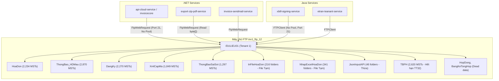
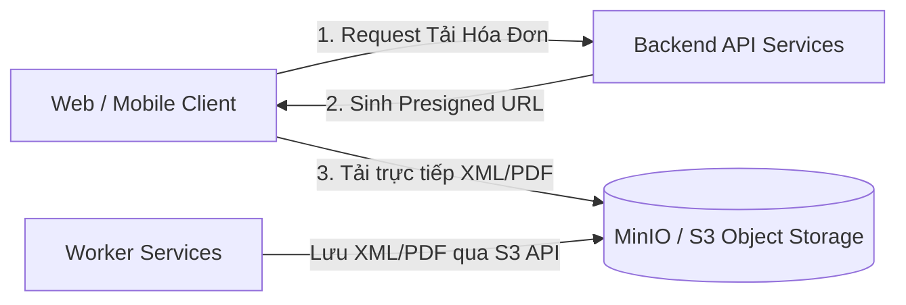

# BÁO CÁO RÀ SOÁT VÀ ĐÁNH GIÁ TOÀN DIỆN HỆ THỐNG LƯU TRỮ SFTP / FTP (XBILL CLOUD)

> **Môi trường rà soát:** Hệ thống xBill Cloud Multi-tenant  
> **Máy chủ lưu trữ:** `inv1_ftp_12` (Thư mục khảo sát: `/DULIEU01`)  
> **Thời gian thực hiện:** 27/09/2026  
> **Phạm vi mã nguồn:** Toàn bộ các service .NET C# (`api-cloud-service`, `api-qldv-service`, `invoicecore`, `invoicemanagement`, `fe-xbill-admin-cloud`, `bill-mobile-api`, `export-zip-pdf-service`, `invoice-sendmail-service`) và Java Spring Boot (`xbill-signing-service`, `etran-teanant-service`, `invoice-java-service`, `createxml-service`, `bangke-dctt-java-service`).

---

## I. TỔNG QUAN KIẾN TRÚC LƯU TRỮ VÀ ÁNH XẠ DỮ LIỆU

### 1. Bản chất phân vùng `DULIEU01`
- Thư mục `/DULIEU01` trên máy chủ lưu trữ `inv1_ftp_12` là thư mục gốc của **Tenant Shard 1 (`TenancyName = "DULIEU01"` / DB `dulieu01`)** — phân vùng tenant lớn nhất trong kiến trúc multi-tenant của xBill Cloud, chứa hàng nghìn doanh nghiệp (MST).
- Quy tắc cấu trúc đường dẫn lưu trữ trong code:
  `Tenant/{TenancyName}/{FolderName}/{MST}/{Folder_Con}/{FileName}` (hoặc lưu trực tiếp tại root của FTP chroot).



---

### 2. Bảng đối chiếu chi tiết 23 thư mục thực tế với mã nguồn

| STT | Thư mục trên `DULIEU01` | Số lượng mục con (MST/Folder) | Ngày cập nhật gần nhất | Dịch vụ thao tác chính | Mục đích lưu trữ & Định dạng file | Đánh giá hiện trạng |
|:---:|:---|:---:|:---:|:---|:---|:---:|
| 1 | `BangKeTongHop` | 4 | 03/08/2022 | `export-zip-pdf-service`, `invoicecore` | Bảng kê tổng hợp HĐĐT gửi CQT (`.xml`) | **Thừa / Không còn phát sinh** |
| 2 | `ChungTu` | 123 | 20/08/2026 | `invoicecore`, `bill-mobile-api`, `invoice-sendmail` | XML chứng từ khấu trừ thuế TNCN điện tử | Đang hoạt động |
| 3 | `ChungTuMau` | 96 | 18/08/2026 | `invoicecore`, `api-cloud-service` | Mẫu thiết kế chứng từ (`.xslt`, `.html`) | Đang hoạt động |
| 4 | `DangKy` | 2,270 | 21/08/2025 | `invoicecore`, `api-cloud-service` | Tờ khai 01/ĐKTĐ-HĐĐT đăng ký sử dụng HĐĐT (`.xml`) | Đang hoạt động |
| 5 | `DangKyChungTu` | 106 | 19/08/2026 | `invoicecore`, `bill-mobile-api` | Đăng ký sử dụng chứng từ khấu trừ thuế (`.xml`) | Đang hoạt động |
| 6 | `FileDinhKemHoaDons` | 116 | 25/09/2026 | `invoicecore`, `bill-mobile-api`, `api-cloud` | File đính kèm gửi cùng HĐ (`.pdf`, `.xlsx`, `.docx`) | **Nặng (rủi ro phình disk)** |
| 7 | `HDTuHeThongKhac` | 19 | 17/10/2025 | `invoicecore`, `bill-mobile-api` | Hóa đơn import từ hệ thống bên ngoài (`.xml`, `.xlsx`) | Đang hoạt động |
| 8 | `HoaDon` | **2,234** | 02/02/2026 | Hầu hết các service (.NET & Java) | File XML hóa đơn gốc, điều chỉnh, thay thế, biên bản | **Cực nặng (Folder lớn nhất)** |
| 9 | `HoaDonMau` | **3,009** | 17/12/2024 | `api-cloud-service`, `invoicecore` | Mẫu hóa đơn cũ (thời TT32 & đầu TT78) | **Thừa 1 phần / Trùng lặp** |
| 10 | `HoaDonPos` | 9 | 07/07/2025 | `api-cloud-service`, `export-zip-pdf-service` | XML hóa đơn máy tính tiền POS (`.xml`) | Đang hoạt động |
| 11 | `HopDong` | 3 | 16/10/2020 | `api-cloud-service`, `bill-mobile-api` | File hợp đồng dịch vụ scan (`.pdf`) | **Thừa (Chết từ 2020)** |
| 12 | `InFileHoaDon` | 216 | 22/09/2026 | `export-zip-pdf-service` (`ZipPdfInvConsumer`) | File ZIP in hóa đơn hàng loạt (`Print.zip`) | **Thừa file tạm / Không có cron dọn** |
| 13 | `JsonInputAPI` | 46 | 18/09/2026 | `api-cloud-service`, `api-qldv-service` | Ghi log JSON request body khi gọi API xuất HĐ | **Gây thắt cổ chai I/O / Thừa** |
| 14 | `NhapExcelHoaDon` | 341 | 24/09/2026 | `api-cloud-service`, `invoicecore` | File Excel người dùng tải lên để import HĐ lô | **Thừa file tạm / Không có cron dọn** |
| 15 | `TBPH` | **2,620** | 19/05/2022 | `invoicecore`, `api-qldv-service` | Thông báo phát hành HĐ (Thông tư 32 cũ) | **Thừa 100% (TT32 đã bãi bỏ)** |
| 16 | `ThongBao_HDMau` | **2,870** | 15/07/2025 | `api-cloud-service`, `export-zip-pdf-service` | Mẫu hóa đơn chuẩn Thông tư 78 (`.xslt`, `.xml`) | Đang hoạt động |
| 17 | `ThongBaoSaiSot` | **1,297** | 11/07/2025 | `api-cloud-service`, `invoicecore` | Thông báo HĐĐT có sai sót (Mẫu 04/SS-HĐĐT) | Đang hoạt động |
| 18 | `ThongBaoSaiSotCTBL` | 4 | 22/04/2026 | `invoicecore` | Thông báo sai sót chứng từ, biên lai (`.xml`) | Đang hoạt động (ít phát sinh) |
| 19 | `ThongDiepHoaDonPos` | 9 | 07/07/2025 | `export-zip-pdf-service`, `bill-mobile-api` | Thông điệp CQT cho hóa đơn POS (`.xml`) | Đang hoạt động |
| 20 | `ThongDiepThue` | 6 | 05/12/2025 | `api-cloud-service`, `invoicecore`, `etran` | Thông điệp CQT cho hóa đơn thường (`.xml`) | Đang hoạt động |
| 21 | `ThongDiepThueChungTu` | 3 | 01/07/2025 | `invoicecore`, `bill-mobile-api` | Thông điệp CQT cho chứng từ thuế (`.xml`) | Đang hoạt động (ít phát sinh) |
| 22 | `XmlCapMa` | **1,849** | 14/09/2026 | `etran-teanant-service`, `invoice-java-service` | File XML thông điệp 202 trả về từ CQT sau khi cấp mã | Đang hoạt động |
| 23 | `XmlTBSSPhanHoi` | **1,152** | 27/07/2026 | `etran-teanant-service`, `createxml-service` | File XML thông điệp 204 CQT phản hồi sai sót | Đang hoạt động |

---

## II. PHÂN TÍCH CHUYÊN SÂU 3 NHÓM VẤN ĐỀ

---

### 1. NHÓM LOGIC THỪA (DEAD CODE & DỮ LIỆU RÁC)

#### 1.1. Thư mục và nghiệp vụ Thông tư 32 cũ (`TBPH`)
- **Vị trí trong code:**
  - [`FilePath.cs`](file:///Users/vuvantien/Work/CyberLotus/xBill/cloud/api-cloud-service/src/hddt/WS.Application/Commons/FileManagers/FilePath.cs)
  - [`ThongBaoPhatHanhAppService.cs`](file:///Users/vuvantien/Work/CyberLotus/xBill/cloud/api-cloud-service/src/hddt/WS.Application/AppServices/HoaDon/ThongBaoPhatHanhAppService.cs#L762)
- **Thực trạng:**
  - Nghiệp vụ *Thông báo phát hành hóa đơn* theo TT32 đã chấm dứt hoàn toàn hiệu lực từ 01/07/2022 khi cả nước chuyển đổi sang HĐĐT TT78.
  - Thư mục `TBPH` trên máy chủ lưu trữ dừng cập nhật từ ngày **19/05/2022** nhưng vẫn đang chiếm **2,620 thư mục MST**.
  - Các app service vẫn còn logic sinh file `TBPH_{MST}_{yyyyMMdd}.xml` và `TBPH.pdf`.

#### 1.2. Nghiệp vụ `HopDong` (Lưu trữ hợp đồng dịch vụ qua FTP)
- **Vị trí trong code:** [`FilePath.cs`](file:///Users/vuvantien/Work/CyberLotus/xBill/cloud/api-cloud-service/src/hddt/WS.Application/Commons/FileManagers/FilePath.cs#L250-L267)
- **Thực trạng:**
  - Thư mục `HopDong` chỉ có đúng **3 thư mục** từ ngày **16/10/2020** đến nay không phát sinh thêm.
  - Hiện tại nghiệp vụ hợp đồng và gói cước đã được chuyển dịch hoàn toàn sang hệ thống quản lý dịch vụ (QLDV) và database, logic upload file hợp đồng lên FTP này đã bị bỏ quên.

#### 1.3. Trùng lặp giữa `HoaDonMau` và `ThongBao_HDMau`
- **Vị trí trong code:**
  - `HDMau_XSLT(DMDoanhNghiep_HDMau)` -> Trỏ vào `HoaDonMau` ([FilePath.cs#L212](file:///Users/vuvantien/Work/CyberLotus/xBill/cloud/api-cloud-service/src/hddt/WS.Application/Commons/FileManagers/FilePath.cs#L212))
  - `HDMau_XSLT(HD_ThongBao_HDMau)` -> Trỏ vào `ThongBao_HDMau` ([FilePath.cs#L136](file:///Users/vuvantien/Work/CyberLotus/xBill/cloud/api-cloud-service/src/hddt/WS.Application/Commons/FileManagers/FilePath.cs#L136))
- **Thực trạng:**
  - Tồn tại 2 thư mục mẫu hóa đơn chạy song song (`HoaDonMau` có 3,009 MST và `ThongBao_HDMau` có 2,870 MST).
  - Gây lãng phí tài nguyên và rủi ro tải nhầm phiên bản file XSLT cũ khi xuất PDF hóa đơn.

#### 1.4. Ghi file JSON Request Body vào FTP (`JsonInputAPI`)
- **Vị trí trong code:** [`FilePath.cs`](file:///Users/vuvantien/Work/CyberLotus/xBill/cloud/api-cloud-service/src/hddt/WS.Application/Commons/FileManagers/FilePath.cs#L86-L113) (`GuiHoaDonPath`)
- **Thực trạng:**
  - Mỗi khi client gọi API phát hành hóa đơn (`GuiHoaDonGoc`, `GuiHoaDonDieuChinh`, `GuiHoaDonTT`, `GuiHoaDonXoa`), backend đều tuần tự serialize request body và ghi một file `.json` lên máy chủ FTP qua mạng:
    `Tenant/{TenantCode}/JsonInputAPI/{MST}/{LoaiGui}/{MST}_{MauSo}-{KyHieu}-{MaHoSo}.json`
  - Đây là logic thừa thãi, gây nghẽn I/O trực tiếp trên luồng phát hành hóa đơn. Nếu cần audit payload, phải đẩy vào Elasticsearch / Kafka / File log cục bộ bất đồng bộ thay vì ghi synchronous FTP.

#### 1.5. Thư mục file tạm không có cơ chế dọn dẹp (`InFileHoaDon`, `NhapExcelHoaDon`)
- **Vị trí trong code:**
  - `InFileHoaDon`: [`FilePath.cs (export-zip-pdf-service)`](file:///Users/vuvantien/Work/CyberLotus/xBill/cloud/export-zip-pdf-service/Common/FTPHelper/FilePath.cs#L39)
  - `NhapExcelHoaDon`: [`FilePath.cs (invoicecore)`](file:///Users/vuvantien/Work/CyberLotus/xBill/cloud/invoicecore/aspnet-core/src/hddt/HDDT.Application/Commons/FileManagers/FilePath.cs#L44)
- **Thực trạng:**
  - Các file `Print.zip` (in hàng loạt) và các file Excel người dùng tải lên import không bao giờ bị xóa. Không có background worker hay cronjob quản lý vòng đời (Retention policy), dẫn đến phình to dung lượng ổ đĩa theo thời gian.

#### 1.6. Code rác C# trong các service Java
- **Vị trí trong code:**
  - [`FTPUtils.java (etran-teanant-service)`](file:///Users/vuvantien/Work/CyberLotus/xBill/cloud/etran-teanant-service/src/main/java/vn/sample/multitenancy/utils/FTPUtils.java#L150-L215)
  - [`FTPUtils.java (xbill-signing-service)`](file:///Users/vuvantien/Work/CyberLotus/xBill/cloud/xbill-signing-service/src/main/java/com/service/utils/FTPUtils.java#L25-L62)
- **Thực trạng:** Hàng chục dòng code C# .NET (`FtpWebRequest`, `NetworkCredential`) được sao chép nguyên trạng vào file Java và bị comment lại vì không thể biên dịch.

---

### 2. NHÓM LOGIC NẶNG (HIỆU NĂNG KÉM & BĂNG THÔNG)

#### 2.1. Lệnh PWD (`PrintWorkingDirectory`) bị gọi lặp lại trên từng Request
- **Vị trí trong code:** [`FileManager.cs (api-cloud-service)`](file:///Users/vuvantien/Work/CyberLotus/xBill/cloud/api-cloud-service/src/hddt/WS.Application/Commons/FileManagers/FileManager.cs#L34-L53)
```csharp
private string FtpHomePath {
    get {
        if (string.IsNullOrWhiteSpace(_ftpHomePath)) {
            string ftpUrl = string.Format("ftp://{0}/", FtpUrl);
            FtpWebRequest req = (FtpWebRequest)FtpWebRequest.Create(ftpUrl);
            req.Method = WebRequestMethods.Ftp.PrintWorkingDirectory;
            req.Credentials = new NetworkCredential(FtpUsername, FtpPassword);
            req.Timeout = 100000;
            var res = (FtpWebResponse)req.GetResponse();
            // ... regex lấy home path
            res.Close();
        }
        return _ftpHomePath;
    }
}
```
- **Hậu quả:** `FileManager` được đăng ký qua `ITransientDependency` (vòng đời transient, tạo mới mỗi khi inject). Bất kỳ thao tác đọc hoặc ghi file nào cũng tốn **thêm 1 network roundtrip độc lập** chỉ để hỏi thư mục gốc của FTP server!

#### 2.2. Tạo thư mục đệ quy qua mạng bằng nhiều lệnh tuần tự (`CreateSubDirFTP` / `makeDirectories`)
- **Vị trí trong code:**
  - C#: [`FileManager.cs`](file:///Users/vuvantien/Work/CyberLotus/xBill/cloud/api-cloud-service/src/hddt/WS.Application/Commons/FileManagers/FileManager.cs#L154-L183)
  - Java: [`FTPUtils.java`](file:///Users/vuvantien/Work/CyberLotus/xBill/cloud/xbill-signing-service/src/main/java/com/service/utils/FTPUtils.java#L64-L83)
- **Cơ chế lỗi:** Khi lưu một file XML vào đường dẫn có 5 cấp thư mục (`Tenant/DULIEU01/HoaDon/0101234567/1_1C23TAA_123`):
  Nếu thư mục chưa có, code cắt chuỗi theo dấu `/` và chạy vòng lặp gửi tuần tự 5 lệnh `MKD` qua FTP.
- **Hậu quả:** 5 lần mở kết nối mạng tuần tự, gây tăng latency phát hành hóa đơn thêm **500ms - 2,000ms** cho mỗi request khi vào thư mục mới.

#### 2.3. Tắt TCP KeepAlive (`KeepAlive = false`) & Không có Connection Pool
- **Vị trí trong code:**
  - .NET: [`FileManager.cs#L91`](file:///Users/vuvantien/Work/CyberLotus/xBill/cloud/api-cloud-service/src/hddt/WS.Application/Commons/FileManagers/FileManager.cs#L91) (`req.KeepAlive = false;`)
  - Java: [`FTPUtils.java#L87`](file:///Users/vuvantien/Work/CyberLotus/xBill/cloud/xbill-signing-service/src/main/java/com/service/utils/FTPUtils.java#L87) (`new FTPClient()`)
- **Hậu quả:**
  - Ép đóng TCP socket ngay sau khi xong 1 file. Khi hệ thống có tải cao (hàng chục nghìn hóa đơn/giờ), máy chủ backend rơi vào tình trạng **cạn kiệt cổng mạng nội bộ (TCP port exhaustion)** do hàng chục nghìn socket kẹt ở trạng thái `TIME_WAIT`.
  - Phía máy chủ FTP (`inv1_ftp_12`) bị quá tải CPU do phải liên tục xử lý bắt tay TCP và xác thực USER/PASS.

#### 2.4. Đọc/ghi toàn bộ file qua RAM dưới dạng mảng byte (`byte[]`)
- **Vị trí trong code:** [`FileManager.cs (export-zip-pdf-service)`](file:///Users/vuvantien/Work/CyberLotus/xBill/cloud/export-zip-pdf-service/Common/FTPHelper/FileManager.cs#L174-L202)
- **Hậu quả:** Hàm `DownloadFile` nạp toàn bộ file vào `MemoryStream` rồi gọi `ToArray()`. Đối với các file `Print.zip` in hàng nghìn hóa đơn (dung lượng từ 50MB đến 300MB), các buffer byte này rơi thẳng vào **Large Object Heap (LOH)** của .NET Core. Việc này gây phân mảnh bộ nhớ RAM nghiêm trọng, kích hoạt Gen 2 Garbage Collector (GC Pause) làm đơ toàn bộ tiến trình worker và gây crash Out-Of-Memory (OOM).

---

### 3. NHÓM LOGIC CÓ VẤN ĐỀ (BUGS TIỀM ẨN & RỦI RO BẢO MẬT)

#### 3.1. BUG NGHIÊM TRỌNG: Đóng Socket trước khi đọc Stream (`getDataFromFtp`)
- **Vị trí trong code:** [`FTPUtils.java (xbill-signing-service)`](file:///Users/vuvantien/Work/CyberLotus/xBill/cloud/xbill-signing-service/src/main/java/com/service/utils/FTPUtils.java#L124-L149) và `invoice-java-service`
```java
public InputStream getDataFromFtp(String pathFile) {
    FTPClient client = new FTPClient();
    try {
        client.connect(ftpUrlConfig);
        client.login(ftpUsername, ftpPassword);
        // ...
        InputStream inputStream = client.retrieveFileStream(pathFile);
        boolean success = client.completePendingCommand(); // LỖI 1: Gọi trước khi đọc stream
        client.logout();
        return inputStream; // LỖI 2: Trả về stream nhưng socket đã bị đóng ở finally!
    } catch (Exception e) {
        log.error("getDataFromFtp E", e);
    } finally {
        try {
            client.disconnect(); // ĐÓNG SOCKET TẠI ĐÂY!
        } catch (IOException e) { ... }
    }
    return null;
}
```
- **Phân tích lỗi:**
  1. `client.completePendingCommand()` bị gọi trước khi đọc byte nào từ `inputStream` -> vi phạm quy chuẩn Apache Commons Net.
  2. Khối `finally` gọi `client.disconnect()` đóng socket ngay lập tức, nhưng hàm lại return `inputStream`. Bất kỳ bên nào gọi `inputStream.read()` sẽ lập tức văng ngoại lệ `java.net.SocketException: Socket closed`.

#### 3.2. Nuốt Exception và âm thầm trả về `null`
- **Vị trí trong code:** [`FileManager.cs (api-cloud-service)`](file:///Users/vuvantien/Work/CyberLotus/xBill/cloud/api-cloud-service/src/hddt/WS.Application/Commons/FileManagers/FileManager.cs#L204-L215)
```csharp
catch (WebException e) {
    Logger.Error("1-", e);
    return null;
}
catch (Exception ex) {
    return null;
}
```
- **Hậu quả:** Khi FTP timeout, sai mật khẩu hoặc mất kết nối, hàm âm thầm trả về `null`. Service cấp cao không nhận diện được sự cố mạng mà dính lỗi dây chuyền `NullReferenceException`, gây khó khăn tối đa cho đội ngũ trực vận hành khi điều tra log.

#### 3.3. Ghi log hoạt động bình thường ở cấp độ `ERROR` (Log Pollution)
- **Vị trí trong code:** [`FileManager.cs`](file:///Users/vuvantien/Work/CyberLotus/xBill/cloud/api-cloud-service/src/hddt/WS.Application/Commons/FileManagers/FileManager.cs#L86-L167)
  - `Logger.Error("URL: " + fullUrl);`
  - `Logger.Error("currentDir: " + currentDir);`
- **Hậu quả:** Mọi thao tác đọc ghi bình thường đều bị ghi thành `ERROR`. Làm ngập hệ thống tập trung log (ELK/Graylog), kích hoạt cảnh báo giả và che lấp các lỗi nghiệp vụ thực sự.

#### 3.4. Sử dụng giao thức FTP Plaintext không mã hóa (Port 21)
- Dù gọi là "SFTP" nhưng thực tế cấu hình kết nối là FTP truyền thống:
  - C# sử dụng `FtpWebRequest` với scheme `ftp://` (cổng 21).
  - Java sử dụng `org.apache.commons.net.ftp.FTPClient` (cổng 21).
- **Rủi ro:** Toàn bộ thông tin đăng nhập (`hddt`) và nội dung hóa đơn (giá trị tiền, thuế, MST, khách hàng) truyền qua mạng nội bộ không có mã hóa TLS/SSH.

---

## III. BẢNG PHÂN LOẠI VÀ XẾP HẠNG MỨC ĐỘ NGHIÊM TRỌNG

| Xếp hạng | Mã ID | Tên vấn đề | Bản chất kỹ thuật | Dịch vụ ảnh hưởng | Mức độ tác động |
|:---:|:---:|:---|:---|:---|:---|
| **CRITICAL** | **C-01** | Thiếu Connection Pool + `KeepAlive = false` | Cạn TCP Socket (`TIME_WAIT`), quá tải FTP handshake | `api-cloud`, `export-zip-pdf`, `xbill-signing` | **Treo hệ thống giờ cao điểm** |
| **CRITICAL** | **C-02** | Bug đóng Socket trước khi đọc Stream (`getDataFromFtp`) | Trả về Stream trên Socket đã `disconnect()` | `xbill-signing-service`, `invoice-java-service` | **Lỗi runtime Socket Closed** |
| **CRITICAL** | **C-03** | Thao tác FTP đồng bộ trên Request Thread HTTP | Chặn luồng worker của ASP.NET Core khi FTP lag | `api-cloud-service`, `api-qldv-service` | **HTTP 504 Gateway Timeout** |
| **HIGH** | **H-01** | `CreateSubDirFTP` tạo thư mục đệ quy qua nhiều roundtrip mạng | Gửi tuần tự 4-5 lệnh `MKD` mỗi khi vào folder mới | `FileManager.cs`, `FTPUtils.java` | **Tăng latency 0.5s - 2s/request** |
| **HIGH** | **H-02** | Nạp toàn bộ file lớn vào RAM (`byte[]`) | Ép cấp phát trên LOH (Large Object Heap) | `export-zip-pdf-service` (Zip/PDF) | **GC Pause kéo dài & OOM Pod** |
| **HIGH** | **H-03** | Nuốt Exception trả về `null` trong `DownloadFile` | Catch all và return `null`, che giấu lỗi hạ tầng | `FileManager.cs` | **Lỗi NullReference dây chuyền** |
| **MEDIUM** | **M-01** | Thư mục tạm (`InFileHoaDon`, `NhapExcelHoaDon`) không dọn | Thiếu retention policy / lifecycle cleanup | Máy chủ lưu trữ `inv1_ftp_12` | **Đầy ổ đĩa / cạn inode** |
| **MEDIUM** | **M-02** | Ghi log `Logger.Error` cho flow chạy bình thường | Ghi URL và currentDir ở level `Error` | `api-cloud-service`, `api-qldv-service` | **Ô nhiễm cảnh báo ELK/Graylog** |
| **MEDIUM** | **M-03** | Giao thức FTP Plaintext (Port 21) không mã hóa | Không dùng SFTP (SSH Port 22) hay FTPS | Toàn bộ các service kết nối storage | **Rủi ro lộ bí mật dữ liệu** |
| **LOW** | **L-01** | Thư mục và logic thừa thời TT32 (`TBPH`, `HopDong`, `BangKeTongHop`) | Nghiệp vụ đã bãi bỏ hoặc không còn sử dụng | Mã nguồn C# và ổ đĩa FTP | **Lãng phí dung lượng & rác code** |
| **LOW** | **L-02** | Code C# comment out trong các file Java `FTPUtils.java` | Sao chép code sai ngôn ngữ | `etran`, `createxml`, `invoice-java` | **Khó bảo trì mã nguồn** |
| **LOW** | **L-03** | Trùng lặp code `FileManager.cs` trên 6 project | Copy-paste mã nguồn không qua thư viện chung | Các service .NET | **Không đồng bộ khi vá lỗi** |

---

## IV. LỘ TRÌNH VÀ PHƯƠNG ÁN XỬ LÝ (ACTION PLAN)

### Giai đoạn 1: Khắc phục sự cố & Tối ưu ngay lập tức (Thời gian: 1 - 2 tuần)

1. **Khử bỏ roundtrip PWD thừa:**
   - Trong `FileManager.cs`: Xóa bỏ property `FtpHomePath` gọi `WebRequestMethods.Ftp.PrintWorkingDirectory`.
   - Cố định đường dẫn gốc là `/` hoặc lấy từ `appsettings.json`.
2. **Khắc phục nghẽn Socket mạng:**
   - Trong C#: Đổi `req.KeepAlive = true;` để cho phép tái sử dụng kết nối TCP.
   - Trong Java: Tích hợp thư viện connection pool (ví dụ: dùng `commons-pool2` quản lý pool `FTPClient`).
3. **Bộ đệm thư mục đã tồn tại (Cache Directory Structure):**
   - Áp dụng `IMemoryCache` (hoặc `ConcurrentDictionary`) để lưu các đường dẫn thư mục đã tạo (ví dụ: `Tenant/DULIEU01/HoaDon/0101234567/1_1C23TAA_123`).
   - Nếu Cache Hit -> Bỏ qua hoàn toàn việc gọi `CreateSubDirFTP` / `makeDirectories`.
4. **Vá lỗi và dọn dẹp mã nguồn:**
   - Sửa hàm `getDataFromFtp` trong Java: Đọc toàn bộ nội dung stream vào `ByteArrayOutputStream` hoặc mảng byte trước khi gọi `disconnect()`, hoặc xóa bỏ hẳn nếu không có caller.
   - Chuyển `Logger.Error("URL:...")` thành `Logger.Debug(...)`.
   - Xóa bỏ các đoạn code C# comment out trong các file `FTPUtils.java`.
5. **Cài đặt Cronjob dọn dẹp file tạm trên server `inv1_ftp_12`:**
   - `InFileHoaDon`: Xóa các file `.zip` tạo quá **7 ngày**.
   - `NhapExcelHoaDon`: Xóa các file `.xlsx` tạo quá **30 ngày**.
   - `JsonInputAPI`: Tắt logic ghi file này từ backend, xóa các file cũ hơn **15 ngày**.

---

### Giai đoạn 2: Tái cấu trúc chuẩn hóa lưu trữ (Thời gian: 1 - 2 tháng)

1. **Chuyển sang Stream-based I/O:**
   - Cải tiến interface `IFileManager`:
     ```csharp
     Task UploadFileAsync(string filePath, Stream stream, CancellationToken cancellationToken);
     Task<Stream> DownloadFileStreamAsync(string filePath, CancellationToken cancellationToken);
     ```
   - Chuyển toàn bộ luồng tạo ZIP / đọc file in hóa đơn sang cơ chế streaming trực tiếp, giải phóng hoàn toàn bộ nhớ RAM Large Object Heap (LOH).
2. **Thống nhất thư viện hiện đại cho .NET:**
   - Thay thế hoàn toàn `FtpWebRequest` (đã bị Microsoft deprecate) bằng **`FluentFTP`** (hỗ trợ Connection Pooling, tự động tái kết nối, hỗ trợ async/await chuẩn và FTPS).
3. **Đóng gói Shared Storage Library:**
   - Tách toàn bộ logic lưu trữ file thành module thư viện dùng chung `CyberBill.Storage.Core` thay vì copy-paste qua 6 solution khác nhau.

---

### Giai đoạn 3: Hiện đại hóa kiến trúc lưu trữ dài hạn (Kiến trúc đích)



- **Chuyển đổi từ FTP Server truyền thống sang Object Storage (MinIO / Ceph S3-compatible):**
  - **Khắc phục điểm nghẽn Metadata:** Khi số lượng hóa đơn lên tới hàng chục triệu file, hệ thống file Linux (ext4/xfs) của FTP server sẽ bị chậm nghiêm trọng khi tra cứu thư mục. Object Storage giải quyết triệt để vấn đề này.
  - **Cơ chế Presigned URL:** Cho phép trình duyệt của khách hàng tải file PDF/XML trực tiếp từ Storage mà không cần đi qua Backend API làm nghẽn luồng xử lý.
  - **Tự động quản lý vòng đời (Lifecycle Policies):** Cấu hình tự động xóa file tạm (`InFileHoaDon`, `NhapExcelHoaDon`) sau N ngày ngay trên tầng hạ tầng lưu trữ.
  - **Bảo mật chuẩn doanh nghiệp:** Hỗ trợ mã hóa đường truyền HTTPS/TLS và mã hóa dữ liệu tĩnh (Server-Side Encryption).
